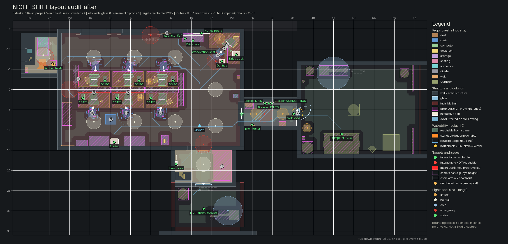

# Layout audit: after

Source: `src @ c6f0124+local changes`. Generated headlessly by `tools/audit/run.sh` from the real `MapBuilder.luau` (Lune) and the converted meshes. 
This is an offline approximation (boxes + sampled meshes, no physics, prompts measured from a 3-stud root height); confirm in a Studio playtest.

## Metrics

| Metric | before-local | after |
|---|---|---|
| Desks (Layout.DESKS) | 6 | 6 |
| Art props placed (visible) | 120 | 104 |
| Art props indoors | 101 | 88 |
| Art props in the main office | 78 | 74 |
| Avg objects on a desk (incl. PC kit) | 5.5 | 5.33 |
| Avg personal objects per desk | 1.5 | 1.33 |
| Weathered / trash / hazard props indoors | 1 | 1 |
| Weathered / trash props outdoors | 8 | 6 |
| Dirty-named surface textures indoors (faces) | 0 | 0 |
| Worst painted-wall texture: % dark blotch pixels | 0.0 | 0.0 |
| Worst ceiling texture: % dark blotch pixels | 7.04 | 7.04 |
| Prop-prop box overlaps (> 0.05, not resting) | 36 | 17 |
| ...of which mesh surfaces meet | 21 | 4 |
| Deepest mesh-confirmed prop overlap | 1.748 | 0.129 |
| Props into walls / glass / ceiling (> 0.1) | 20 | 0 |
| Props touching wall trim | 45 | 22 |
| Props inside other furniture collision | 31 | 7 |
| Props sunk below floor / desk top | 13 | 0 |
| Camera-clip props (eye-zone overhang > 0.3) | 4 | 0 |
| Largest eye-zone overhang (99 = no collision) | 1.488 | 0.292 |
| Props whose mesh renders far from its anchor | 20 | 0 |
| Art keys with implausible size (heuristic) | 9 | 0 |
| Interactables reachable | 22 | 22 |
| Interactables checked | 22 | 22 |
| Routes narrower than 3.5 | 1 | 1 |
| Narrowest route width | 2.75 | 2.75 |
| ...to | Dumpster | Dumpster |
| Chairs with < 2.5 free behind | 0 | 0 |
| Least free floor behind a chair | 4.55 | 4.15 |
| Chairs not facing their desk (> 45 deg) | 6 | 0 |
| Walkable area reachable from spawn (sq studs) | 1337.1 | 1167.1 |
| Standable but unreachable area (sq studs) | 0.0 | 4.6 |
| Lights | 26 | 36 |
| Amber lights | 6 | 6 |
| Cold lights | 3 | 3 |
| Collision proxies | 41 | 46 |
| Issues listed | 102 | 15 |

## Top issues

| # | Severity | Kind | Issue |
|---|---|---|---|
| 1 | medium | weathered-indoor | trash_can#1 (Kitchen) at (-24.0, -6.2) is a weathered/trash/hazard asset indoors. |
| 2 | low | narrow-route | Route spawn -> Dumpster: narrowest point is the rear door (2.8 studs clear at (36.1, 5.9)); door openings are fixed by Layout. |
| 3 | low | overhang | conference_chair_grey#1 at (-9.8, 0.0, 7.4): mesh outside the eye zone (3-4 or 5.8-6.5 studs) reaches 2.13 studs beyond collision. |
| 4 | low | overhang | office_chair_grey#2 at (16.5, 0.6, -8.5): mesh outside the eye zone (3-4 or 5.8-6.5 studs) reaches 1.89 studs beyond collision. |
| 5 | low | prop-overlap | divider_black_low#2 intersects desk2_alt4#1 by 0.13 studs at (-5.6, 1.6, 0.7) (mesh surfaces meet: 42 voxels). |
| 6 | low | prop-overlap | divider_black_low#1 intersects desk2_alt3#1 by 0.13 studs at (-14.0, 1.6, 0.7) (mesh surfaces meet: 42 voxels). |
| 7 | low | overhang | desk2_corner#1 at (18.1, 0.0, -10.2): mesh outside the eye zone (3-4 or 5.8-6.5 studs) reaches 0.73 studs beyond collision. |
| 8 | low | prop-overlap | divider_black_low_half#1 intersects desk2#1 by 0.07 studs at (-17.8, 1.6, -2.6) (mesh surfaces meet: 9 voxels). |
| 9 | low | prop-overlap | computer_keyboard#7 intersects computer_monitor#7 by 0.07 studs at (19.0, 3.2, -11.0) (mesh surfaces meet: 46 voxels). |
| 10 | low | overhang | wall_clock#1 at (4.0, 7.2, -13.9): mesh outside the eye zone (3-4 or 5.8-6.5 studs) reaches 0.56 studs beyond collision. |
| 11 | low | overhang | computer_keyboard#7 at (18.7, 3.1, -10.7): mesh outside the eye zone (3-4 or 5.8-6.5 studs) reaches 0.47 studs beyond collision. |
| 12 | low | overhang | couch_pattern#1 at (17.5, 0.0, 19.0): mesh outside the eye zone (3-4 or 5.8-6.5 studs) reaches 0.41 studs beyond collision. |
| 13 | low | overhang | office_chair_blue_alt#1 at (2.4, 0.5, 5.8): mesh outside the eye zone (3-4 or 5.8-6.5 studs) reaches 0.36 studs beyond collision. |
| 14 | low | overhang | office_chair_black_alt#1 at (-6.0, 0.5, 5.8): mesh outside the eye zone (3-4 or 5.8-6.5 studs) reaches 0.36 studs beyond collision. |
| 15 | low | overhang | office_chair_grey_alt#1 at (-14.4, 0.5, 5.8): mesh outside the eye zone (3-4 or 5.8-6.5 studs) reaches 0.36 studs beyond collision. |

## Interactables and routes

Reachable = some cell a character (radius 1.0) can reach from the spawn is within the prompt distance minus 1 stud (3D, root at y = 3.0). Route width = widest route from the spawn (2 x clearance at its bottleneck). Doors treated open: RearDoor, FrontDoor2, FrontDoor1.

| Target | Position | Prompt | Reach | Reachable | Closest | Route width | Bottleneck |
|---|---|---|---|---|---|---|---|
| Desk 1 tower | (-11.2, 4.2, -2.2) | Shut down PC | 8 | yes | 3.6 | 6.1 | (6.4, -9.1) |
| Desk 2 tower | (-2.9, 4.2, -2.2) | Shut down PC | 8 | yes | 3.6 | 6.1 | (6.4, -9.1) |
| Desk 3 tower | (5.6, 4.2, -2.2) | Shut down PC | 8 | yes | 3.6 | 8.8 | (12.4, -3.1) |
| Desk 4 tower | (-16.8, 4.2, 2.2) | Shut down PC | 8 | yes | 2.4 | 4.2 | (3.1, 8.9) |
| Desk 5 tower | (-8.4, 4.2, 2.2) | Shut down PC | 8 | yes | 3.6 | 4.2 | (3.1, 8.9) |
| Desk 6 tower | (0.1, 4.2, 2.2) | Shut down PC | 8 | yes | 3.6 | 4.2 | (3.1, 8.9) |
| Drive dock | (21.1, 3.6, -8.6) | Dock drive | 8 | yes | 3.3 | 7.2 | (17.1, -2.9) |
| Workstation seat | (16.6, 2.6, -8.6) | Sit down | 9 | yes | 0.4 | 11.4 | (12.1, 9.1) |
| Drive rack | (10.4, 2.6, -12.1) | Stage drive | 8 | yes | 1.5 | 9.0 | (12.4, -4.9) |
| Rack slot (far) | (8.6, 4.5, -12.6) | Take drive | 7 | yes | 2.2 | 8.8 | (10.9, -7.4) |
| Breaker LIGHTS | (29.0, 4.6, 3.4) | Reset breaker | 8 | yes | 2.0 | 4.2 | (22.4, 6.9) |
| Breaker MAIN | (28.2, 4.6, 3.4) | Reset breaker | 8 | yes | 2.0 | 4.2 | (22.4, 6.9) |
| Breaker WORKSTATION | (29.8, 4.6, 3.4) | Reset breaker | 8 | yes | 2.0 | 4.2 | (22.4, 6.9) |
| Rear door | (35.2, 3.6, 6.0) | Open door | 9 | yes | 0.6 | 4.2 | (22.4, 6.9) |
| Kitchen trash | (-24.0, 1.8, -6.2) | Take trash bag | 10 | yes | 2.3 | 6.1 | (6.4, -9.1) |
| Dumpster | (47.0, 3.0, 11.0) | Throw bag away | 10 | yes | 1.1 | 2.8 (narrow) | (36.1, 5.9) |
| Thermostat | (25.0, 4.8, 8.7) | Read thermostat | 10 | yes | 2.0 | 11.4 | (12.1, 9.1) |
| Printer | (-9.0, 4.3, 13.1) | Take printout | 10 | yes | 2.4 | 4.2 | (3.1, 8.9) |
| Out tray | (17.5, 3.2, -6.9) | Leave printout | 10 | yes | 1.6 | 11.4 | (12.1, 9.1) |
| Time clock | (6.2, 4.2, 18.5) | Clock out | 8 | yes | 1.8 | 5.8 | (11.9, 14.1) |
| Notice board | (12.5, 5.6, -13.9) | (read) | 8 | yes | 4.2 | 8.2 | (10.9, -7.6) |
| Front door / escape | (13.0, 4.0, 29.5) | (walk in) | 10 | yes | 0.0 | 3.8 | (12.9, 23.1) |

Prompt parents closer than 2.5 studs (the custom prompt must pick one): Workstation seat / Out tray 2.0; Breaker LIGHTS / Breaker MAIN 0.8; Breaker LIGHTS / Breaker WORKSTATION 0.8; Breaker MAIN / Breaker WORKSTATION 1.6.

## Prop overlaps

OBB separating-axis depth > 0.05; items resting on a desk/cabinet top or stored in storage are excluded (2 nested pairs, 6 shallow vertical contacts up to 0.2). Mesh = sampled surfaces of both meshes share 4+ voxels of 0.1 stud.

| A | B | Depth | Axis | Mesh | At |
|---|---|---|---|---|---|
| office_chair_grey#2 | desk2_corner#1 | 3.12 | vertical | no (0) | (16.5, 1.6, -8.5) |
| office_chair_grey#1 | desk2_alt#1 | 0.47 | horizontal | no (0) | (-5.2, 1.6, -4.3) |
| office_chair_blue#1 | desk2_alt2#1 | 0.35 | horizontal | no (0) | (3.2, 1.6, -4.3) |
| desk_phone_with_cable#1 | computer_monitor#7 | 0.34 | vertical | no (0) | (20.9, 3.3, -12.4) |
| office_chair_black_alt#1 | desk2_alt4#1 | 0.24 | horizontal | no (0) | (-6.0, 1.6, 4.4) |
| office_chair_black#1 | desk2#1 | 0.22 | horizontal | no (0) | (-13.6, 1.6, -4.4) |
| office_chair_grey_alt#1 | desk2_alt3#1 | 0.17 | horizontal | no (0) | (-14.4, 1.6, 4.4) |
| divider_black_low#4 | divider_black_low#3 | 0.15 | horizontal | no (0) | (6.8, 2.0, 0.1) |
| divider_black_low_half#1 | divider_black_low#1 | 0.14 | horizontal | no (0) | (-17.9, 2.0, -0.5) |
| divider_black_low#3 | desk2#2 | 0.13 | horizontal | no (0) | (2.8, 1.6, 0.7) |
| divider_black_low#2 | desk2_alt4#1 | 0.13 | horizontal | yes (42) | (-5.6, 1.6, 0.7) |
| divider_black_low#1 | desk2_alt3#1 | 0.13 | horizontal | yes (42) | (-14.0, 1.6, 0.7) |
| paper_single_sheet#1 | computer_keyboard#6 | 0.10 | horizontal | no (0) | (3.9, 3.2, 3.3) |
| mug_alt#1 | computer_monitor#7 | 0.10 | horizontal | no (0) | (19.2, 3.3, -13.2) |
| divider_black_low_half#1 | desk2#1 | 0.07 | horizontal | yes (9) | (-17.8, 1.6, -2.6) |
| computer_keyboard#7 | computer_monitor#7 | 0.07 | horizontal | yes (46) | (19.0, 3.2, -11.0) |
| office_chair_blue_alt#1 | desk2#2 | 0.06 | horizontal | no (0) | (2.4, 1.6, 4.5) |

## Props into structure, fixtures and other collision

| Prop | Into | Kind | Mesh depth | Box depth | Points | At |
|---|---|---|---|---|---|---|
| metal_rack_stackable#1 | WindowSill | wall | 0.10 | 0.38 | 444 | (10.4, 1.9, -12.8) |
| electrical_junctionbox_small#1 | BreakerBacking | fixture | 0.05 | 0.10 | 2 | (31.4, 5.2, 3.1) |
| books#1 | office__book_things__book_case_with_back_small_Collision (book_case_with_back_small#1) | collision | 0.70 | 1.09 | 9196 | (-17.0, 3.3, 13.2) |
| office_chair_grey#1 | office__desks__desk2_alt_Collision (desk2_alt#1) | collision | 0.23 | 0.37 | 212 | (-5.2, 1.9, -5.8) |
| office_chair_blue#1 | office__desks__desk2_alt2_Collision (desk2_alt2#1) | collision | 0.18 | 0.25 | 150 | (3.2, 1.9, -5.8) |
| divider_black_low#3 | office__dividers__divider_black_low_Collision (divider_black_low#4) | collision | 0.15 | 0.15 | 13867 | (2.8, 2.0, 0.1) |
| desk2#2 | office__dividers__divider_black_low_Collision (divider_black_low#3) | collision | 0.13 | 0.13 | 8805 | (2.8, 1.6, 2.6) |
| desk2_alt4#1 | office__dividers__divider_black_low_Collision (divider_black_low#2) | collision | 0.13 | 0.13 | 16351 | (-5.6, 1.6, 2.6) |
| desk2_alt3#1 | office__dividers__divider_black_low_Collision (divider_black_low#1) | collision | 0.13 | 0.13 | 17995 | (-14.0, 1.6, 2.6) |
| office_chair_black#1 | office__desks__desk2_Collision (desk2#1) | collision | 0.10 | 0.12 | 59 | (-13.6, 1.9, -5.8) |
| desk2#1 | office__dividers__divider_black_low_half_Collision (divider_black_low_half#1) | collision | 0.07 | 0.07 | 8109 | (-14.0, 1.6, -2.6) |
| office_chair_black_alt#1 | office__desks__desk2_alt4_Collision (desk2_alt4#1) | collision | 0.04 | 0.14 | 4 | (-6.0, 1.9, 5.8) |
| wall_clock#2 | DoorFrame | trim | 0.09 | 0.09 | 62 | (13.0, 9.2, 15.1) |
| door_brown_a#1 | Trim | trim | 0.06 | 0.11 | 30 | (-20.4, 3.3, 13.9) |
| door_brown_a#1 | Trim | trim | 0.06 | 0.11 | 90 | (-20.4, 3.3, 13.9) |
| desk2_corner#1 | Trim | trim | 0.06 | 0.13 | 67 | (18.1, 1.6, -10.2) |
| desk2_corner#1 | Trim | trim | 0.06 | 0.13 | 201 | (18.1, 1.6, -10.2) |
| desk2_corner#1 | Trim | trim | 0.06 | 0.14 | 11 | (18.1, 1.6, -10.2) |
| desk2_corner#1 | Trim | trim | 0.06 | 0.14 | 33 | (18.1, 1.6, -10.2) |
| file_cabinet_largest#1 | Trim | trim | 0.06 | 0.10 | 345 | (-12.7, 2.5, 12.8) |
| file_cabinet_larger_open#1 | Trim | trim | 0.06 | 0.10 | 231 | (-4.0, 1.9, 12.8) |
| file_cabinet_larger_open#1 | Trim | trim | 0.06 | 0.10 | 802 | (-4.0, 1.9, 12.8) |
| papers_log_1_stack#1 | ReceptionTop | trim | 0.05 | 0.05 | 784 | (7.4, 3.1, 21.0) |
| telephone#1 | ReceptionTop | trim | 0.05 | 0.05 | 141 | (8.0, 3.4, 21.6) |
| mug_alt2#1 | CounterTop | trim | 0.05 | 0.05 | 81 | (-29.8, 3.3, -7.3) |
| mug_alt3#1 | CounterTop | trim | 0.05 | 0.05 | 81 | (-29.5, 3.3, -7.8) |
| coffee_machine#1 | CounterTop | trim | 0.05 | 0.05 | 208 | (-29.8, 4.0, -9.5) |
| fire_extenguisher_case#1 | Trim | trim | 0.04 | 0.08 | 24 | (21.6, 3.5, -3.0) |
| door_brown_a#1 | Trim | trim | 0.04 | 0.12 | 2 | (-20.4, 3.3, 13.9) |
| door_brown_a#1 | Trim | trim | 0.04 | 0.12 | 6 | (-20.4, 3.3, 13.9) |
| file_cabinet_largest#1 | Trim | trim | 0.04 | 0.10 | 230 | (-12.7, 2.5, 12.8) |
| door_brown_a#1 | Trim | trim | 0.03 | 0.05 | 216 | (-20.4, 3.3, 13.9) |
| desk2_corner#1 | Trim | trim | 0.03 | 0.08 | 81 | (18.1, 1.6, -10.2) |
| desk2_corner#1 | Trim | trim | 0.03 | 0.07 | 1439 | (18.1, 1.6, -10.2) |

## Camera clipping coverage

Props taller than 1.2 studs (or wall-mounted) with mesh points at 3.0..6.5 studs within 1.0 stud of floor a body can reach face-first. Overhang = horizontal distance from those points to the footprint of the nearest CanCollide part a walking body bumps into (0.4..5.5 studs). Eye zone 4.0..5.8 (camera ~4.5-5 plus near-plane slack): flag (**CLIP**) above 0.3; overhangs outside the eye zone are listed as low. 99 = no collision nearby.

| Prop | At | Height | Eye overhang | Low overhang | Own proxy | Flag |
|---|---|---|---|---|---|---|
| electrical_junctionbox_small#1 | (31.4, 5.2, 3.1) | 0.4 | 0.29 | 0.00 | no |  |
| panel_thermostat#1 | (25.0, 4.6, 8.9) | 1.1 | 0.21 | 0.00 | no |  |
| dumpster_lid_closed#1 | (47.0, 0.0, 13.4) | 4.8 | 0.20 | 0.13 | yes |  |
| door_brown_a#1 | (-20.4, 3.3, 13.9) | 6.6 | 0.19 | 0.19 | no |  |
| fridge#1 | (-26.5, 0.0, -10.6) | 5.1 | 0.14 | 0.28 | yes |  |
| conference_chair_grey#1 | (-9.8, 0.0, 7.4) | 3.5 | 0.00 | 2.13 | no |  |
| office_chair_grey#2 | (16.5, 0.6, -8.5) | 3.8 | 0.00 | 1.89 | no |  |
| desk2_corner#1 | (18.1, 0.0, -10.2) | 3.1 | 0.00 | 0.73 | no |  |
| wall_clock#1 | (4.0, 7.2, -13.9) | 2.1 | 0.00 | 0.56 | no |  |
| computer_keyboard#7 | (18.7, 3.1, -10.7) | 0.1 | 0.00 | 0.47 | no |  |
| couch_pattern#1 | (17.5, 0.0, 19.0) | 4.2 | 0.00 | 0.41 | yes |  |
| office_chair_blue_alt#1 | (2.4, 0.5, 5.8) | 3.9 | 0.00 | 0.36 | yes |  |
| office_chair_black_alt#1 | (-6.0, 0.5, 5.8) | 3.9 | 0.00 | 0.36 | yes |  |
| office_chair_grey_alt#1 | (-14.4, 0.5, 5.8) | 3.9 | 0.00 | 0.36 | yes |  |
| desk2#2 | (2.8, 0.0, 2.6) | 3.1 | 0.00 | 0.13 | yes |  |
| desk2_alt4#1 | (-5.6, 0.0, 2.6) | 3.1 | 0.00 | 0.13 | yes |  |
| desk2_alt3#1 | (-14.0, 0.0, 2.6) | 3.1 | 0.00 | 0.13 | yes |  |
| desk2_alt2#1 | (2.8, 0.0, -2.6) | 3.1 | 0.00 | 0.13 | yes |  |
| desk2_alt#1 | (-5.6, 0.0, -2.6) | 3.1 | 0.00 | 0.13 | yes |  |
| desk2#1 | (-14.0, 0.0, -2.6) | 3.1 | 0.00 | 0.13 | yes |  |
| office_chair_blue#1 | (3.2, 0.6, -5.8) | 3.8 | 0.00 | 0.08 | yes |  |
| office_chair_grey#1 | (-5.2, 0.6, -5.8) | 3.8 | 0.00 | 0.08 | yes |  |
| office_chair_black#1 | (-13.6, 0.6, -5.8) | 3.8 | 0.00 | 0.08 | yes |  |
| papers_log_1_stack#1 | (7.4, 3.1, 21.0) | 0.0 | 0.00 | 0.04 | no |  |
| metaltrashcan_closed#1 | (8.0, 0.0, 25.9) | 3.3 | 0.00 | 0.00 | yes |  |
| plackard_broken#1 | (64.5, 0.0, 12.8) | 5.2 | 0.00 | 0.00 | yes |  |
| plackard_closed#1 | (64.5, 0.0, -2.8) | 5.2 | 0.00 | 0.00 | yes |  |
| concrete_retro_bollard_light#1 | (38.5, 0.0, 9.5) | 4.5 | 0.00 | 0.00 | yes |  |
| street_light#3 | (45.0, 0.0, -4.7) | 23.1 | 0.00 | 0.00 | yes |  |
| yellow_post#2 | (37.6, 2.4, 12.0) | 5.1 | 0.00 | 0.00 | yes |  |
| yellow_post#1 | (37.6, 2.4, -2.0) | 5.1 | 0.00 | 0.00 | yes |  |
| barrel#1 | (62.5, 0.0, -4.0) | 3.0 | 0.00 | 0.00 | yes |  |
| metaltrashcan_overflowing#1 | (39.2, 0.0, -4.6) | 3.1 | 0.00 | 0.00 | yes |  |
| metaltrashcan_closed#2 | (38.6, 0.0, 14.4) | 3.3 | 0.00 | 0.00 | yes |  |
| panel_electric#1 | (24.2, 3.2, 3.9) | 4.2 | 0.00 | 0.00 | yes |  |
| telephone#1 | (8.0, 3.1, 21.6) | 0.6 | 0.00 | 0.00 | no |  |
| file_cabinet_small#1 | (-9.0, 0.0, 13.1) | 3.7 | 0.00 | 0.00 | yes |  |
| panel_electrical_closed#1 | (-30.6, 5.1, -4.9) | 3.5 | 0.00 | 0.00 | yes |  |
| water_cooler_bottle_attached#1 | (21.0, 0.0, 1.6) | 5.2 | 0.00 | 0.00 | yes |  |
| fire_extenguisher_case#1 | (21.6, 3.4, -3.0) | 2.0 | 0.00 | 0.00 | yes |  |

## Chairs

Facing = angle between the seat front (inferred from the backrest in the mesh) and the direction to the desk; 0 is correct, 180 is backwards.

| Desk | Chair | At | Free behind (target 2.5) | Facing error |
|---|---|---|---|---|
| Desk 1 | office_chair_black#1 | (-13.6, -5.7) | 6.6 | 1 deg |
| Desk 2 | office_chair_grey#1 | (-5.2, -5.7) | 6.4 | 12 deg |
| Desk 3 | office_chair_blue#1 | (3.2, -5.7) | 6.5 | 5 deg |
| Desk 4 | office_chair_grey_alt#1 | (-14.4, 5.7) | 4.2 | 9 deg |
| Desk 5 | office_chair_black_alt#1 | (-6.0, 5.7) | 4.2 | 8 deg |
| Desk 6 | office_chair_blue_alt#1 | (2.4, 5.7) | 4.2 | 5 deg |
| Workstation | office_chair_grey#2 | (16.6, -8.6) | 8+ | 1 deg |

Rear door swing: hinge (36.5, 4.5), width 3.0, opens 100 deg outward; obstructions: none.

## Clutter

| Area | Total | appliance | chair | computer | desk | deskitem | divider | outdoor | seating | storage | wall |
|---|---|---|---|---|---|---|---|---|---|---|---|
| Alley | 13 | 0 | 0 | 0 | 0 | 0 | 0 | 13 | 0 | 0 | 0 |
| Hall | 4 | 0 | 0 | 0 | 0 | 0 | 0 | 0 | 0 | 0 | 4 |
| Kitchen | 6 | 2 | 0 | 0 | 0 | 2 | 0 | 1 | 0 | 0 | 1 |
| Lobby | 4 | 0 | 0 | 0 | 0 | 2 | 0 | 0 | 1 | 0 | 1 |
| Office | 74 | 1 | 8 | 27 | 7 | 16 | 5 | 0 | 0 | 6 | 4 |
| Outside | 1 | 0 | 0 | 0 | 0 | 0 | 0 | 1 | 0 | 0 | 0 |
| Street | 2 | 0 | 0 | 0 | 0 | 0 | 0 | 2 | 0 | 0 | 0 |

| Desk | Model | Objects on top | PC kit | Personal | Personal items |
|---|---|---|---|---|---|
| Desk 1 | desk2 | 6 | 4 | 2 | paper_stack, mug |
| Desk 2 | desk2_alt | 5 | 4 | 1 | file_binder |
| Desk 3 | desk2_alt2 | 6 | 4 | 2 | circular_desklamp, paper_stack_large |
| Desk 4 | desk2_alt3 | 5 | 4 | 1 | mug_alt2 |
| Desk 5 | desk2_alt4 | 5 | 4 | 1 | square_desklamp |
| Desk 6 | desk2 | 5 | 4 | 1 | paper_single_sheet |
| Workstation | desk2_corner | 8 | 3 | 5 | papers_envolope_redacted, pen2, desk_phone_with_cable, mug_alt, circular_desklamp |

Weathered / trash / hazard keys placed:

| Prop | Area | Indoor | At |
|---|---|---|---|
| trash_can#1 | Kitchen | yes | (-24.0, -6.2) |
| plackard_broken#1 | Alley | no | (64.5, 12.8) |
| dumpster_lid_closed#1 | Alley | no | (47.0, 13.4) |
| metaltrashcan_closed#2 | Alley | no | (38.6, 14.4) |
| metaltrashcan_overflowing#1 | Alley | no | (39.2, -4.6) |
| trashbag_2_white#1 | Alley | no | (54.6, 14.6) |
| metaltrashcan_closed#1 | Street | no | (8.0, 25.9) |

Surface textures used indoors (blotch = pixels darker than 70% of the median luminance; walls should read as clean, light paint, about 205-226 albedo):

| Surface | Used on | Mean RGB | Median lum | Blotch % | Lum std | Same image as |
|---|---|---|---|---|---|---|
| carpet | floor x1 | (131, 111, 101) | 117 | 3.05 | 17.5 | - |
| ceiling_tile | ceiling x3 | (195, 182, 152) | 183 | 0.01 | 18.1 | - |
| floor_concrete | floor x1 | (97, 105, 79) | 102 | 0.00 | 7.0 | - |
| floor_lobby | floor x1 | (157, 148, 134) | 150 | 5.71 | 27.1 | - |
| floor_tile | floor x1 | (101, 101, 101) | 100 | 5.59 | 17.6 | - |
| wall_concrete | wall x2, ceiling x1 | (118, 122, 112) | 122 | 7.04 | 22.8 | - |
| wall_kitchen | wall x6 | (224, 213, 182) | 213 | 0.00 | 2.9 | - |
| wall_lower | wall x2 | (196, 162, 116) | 165 | 0.00 | 10.8 | - |
| wall_office | wall x25 | (224, 213, 182) | 213 | 0.00 | 2.9 | wall_kitchen |

## Lights

| Area | amber | neutral | cold | emergency | status |
|---|---|---|---|---|---|
| Alley | 1 | 0 | 1 | 0 | 0 |
| Hall | 2 | 0 | 0 | 1 | 1 |
| Kitchen | 0 | 2 | 0 | 1 | 0 |
| Lobby | 0 | 2 | 0 | 0 | 0 |
| Office | 3 | 16 | 0 | 4 | 0 |
| Outside | 0 | 0 | 1 | 0 | 0 |
| Street | 0 | 0 | 1 | 0 | 0 |

## Prompts declared in server code

| File | Parent | Action | Key | Hold | Distance |
|---|---|---|---|---|---|
| src\server\Events\BossRequest.luau:108 | refs.kitchenTrash | Take trash bag | E | 0.6 | 10 |
| src\server\Events\BossRequest.luau:109 | refs.dumpster | Throw bag away | E | 0.6 | 10 |
| src\server\Events\BossRequest.luau:110 | refs.thermostat | Read thermostat | E | 1.0 | 10 |
| src\server\Events\BossRequest.luau:111 | refs.printer | Take printout | E | 0.6 | 10 |
| src\server\Events\BossRequest.luau:112 | refs.outbox | Leave printout | E | 0.4 | 10 |
| src\server\Systems\Doors.luau:131 | MapBuilder.refs.doorPromptPart | Open door | E | 0.3 | 9 |
| src\server\Systems\Drives.luau:487 | p | Take drive | E | 0 | 7 |
| src\server\Systems\Drives.luau:515 | pc | Shut down PC | E | 0.8 | 8 |
| src\server\Systems\Drives.luau:542 | refs.recoveryRack | Stage drive | F | 0 | 8 |
| src\server\Systems\Drives.luau:554 | refs.dock | Dock drive | F | 0.5 | 8 |
| src\server\Systems\Finale.luau:331 | MapBuilder.refs.timeClock | Clock out | E | 0.6 | 8 |
| src\server\Systems\PlayerStatus.luau:123 | root | Help up | E | Config.DOWNED.reviveHold | 9 |
| src\server\Systems\Power.luau:156 | sw | Reset breaker | E | 0.8 | 8 |
| src\server\Systems\Workstation.luau:341 | refs.seatPromptPart | Sit down | E | 0.2 | 9 |
| src\server\Util\Prompts.luau:29 | parent: Instance | ? | E | 0 | 10 |

_Analysis took 3.33 s._
