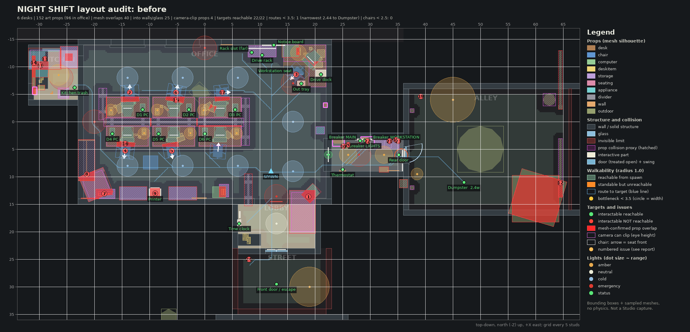

# Layout audit: before

Source: `8dd1dfe (exported Studio baseline)`. Generated headlessly by `tools/audit/run.sh` from the real `MapBuilder.luau` (Lune) and the converted meshes. 
This is an offline approximation (boxes + sampled meshes, no physics, prompts measured from a 3-stud root height); confirm in a Studio playtest.

## Metrics

| Metric | before |
|---|---|
| Desks (Layout.DESKS) | 6 |
| Art props placed (visible) | 152 |
| Art props indoors | 131 |
| Art props in the main office | 96 |
| Avg objects on a desk (incl. PC kit) | 7.17 |
| Avg personal objects per desk | 3.17 |
| Weathered / trash / hazard props indoors | 11 |
| Weathered / trash props outdoors | 10 |
| Dirty-named surface textures indoors (faces) | 0 |
| Worst painted-wall texture: % dark blotch pixels | 0.87 |
| Worst ceiling texture: % dark blotch pixels | 29.9 |
| Prop-prop box overlaps (> 0.05, not resting) | 57 |
| ...of which mesh surfaces meet | 40 |
| Deepest mesh-confirmed prop overlap | 2.339 |
| Props into walls / glass / ceiling (> 0.1) | 25 |
| Props touching wall trim | 10 |
| Props inside other furniture collision | 42 |
| Props sunk below floor / desk top | 18 |
| Camera-clip props (eye-zone overhang > 0.3) | 4 |
| Largest eye-zone overhang (99 = no collision) | 1.488 |
| Props whose mesh renders far from its anchor | 25 |
| Art keys with implausible size (heuristic) | 9 |
| Interactables reachable | 22 |
| Interactables checked | 22 |
| Routes narrower than 3.5 | 1 |
| Narrowest route width | 2.44 |
| ...to | Dumpster |
| Chairs with < 2.5 free behind | 0 |
| Least free floor behind a chair | 4.55 |
| Chairs not facing their desk (> 45 deg) | 6 |
| Walkable area reachable from spawn (sq studs) | 1327.1 |
| Standable but unreachable area (sq studs) | 0.2 |
| Lights | 30 |
| Amber lights | 14 |
| Cold lights | 8 |
| Collision proxies | 41 |
| Issues listed | 150 |

## Top issues

| # | Severity | Kind | Issue |
|---|---|---|---|
| 1 | high | prop-overlap | couch_pattern#1 intersects tv#1 by 2.34 studs at (18.8, 1.7, 13.7) (mesh surfaces meet: 415 voxels). |
| 2 | high | chair-facing | Desk 1 chair office_chair_black#1 at (-13.6, -5.3) faces backwards (backrest against the desk): seat front is 179 deg off the desk direction (model's native front is not +Z; add a yaw for office_chair_black). |
| 3 | high | chair-facing | Workstation chair office_chair_grey#1 at (16.6, -8.6) faces backwards (backrest against the desk): seat front is 179 deg off the desk direction (model's native front is not +Z; add a yaw for office_chair_grey). |
| 4 | high | chair-facing | Desk 4 chair office_chair_orange#1 at (-14.4, 5.3) faces backwards (backrest against the desk): seat front is 172 deg off the desk direction (model's native front is not +Z; add a yaw for office_chair_orange). |
| 5 | high | chair-facing | Desk 5 chair office_chair_black_alt#1 at (-6.0, 5.3) faces backwards (backrest against the desk): seat front is 172 deg off the desk direction (model's native front is not +Z; add a yaw for office_chair_black_alt). |
| 6 | high | chair-facing | Desk 2 chair office_chair_blue#1 at (-5.2, -5.3) faces backwards (backrest against the desk): seat front is 168 deg off the desk direction (model's native front is not +Z; add a yaw for office_chair_blue). |
| 7 | high | prop-overlap | armchair_pattern#1 intersects book_case_with_back_small#1 by 1.75 studs at (-18.2, 2.1, 13.1) (mesh surfaces meet: 529 voxels). |
| 8 | high | prop-overlap | armchair_pattern#1 intersects whiteboard#1 by 1.74 studs at (-21.4, 2.1, 9.5) (mesh surfaces meet: 178 voxels). |
| 9 | high | prop-overlap | file_cabinet_small#2 intersects file_cabinet_small#1 by 1.70 studs at (-9.0, 2.5, 13.1) (mesh surfaces meet: 2508 voxels). |
| 10 | high | camera-clip | panel_electric#1 at (24.2, 3.2, 3.6): mesh at eye height reaches 1.49 studs beyond the collision footprint (worst point (25.1, 5.1, 4.5)); a first-person camera walking up to it can enter the mesh. |
| 11 | high | prop-overlap | fridge#1 intersects coffee_machine#1 by 1.46 studs at (-29.8, 4.8, -10.2) (mesh surfaces meet: 174 voxels). |
| 12 | high | prop-overlap | plackard_broken#1 intersects wood_pallet#2 by 1.35 studs at (64.5, 0.9, 11.1) (mesh surfaces meet: 156 voxels). |
| 13 | high | into-structure | fridge#1 penetrates wall 'Counter' by 1.29 studs (mesh) near (-29.0, 3.2, -11.4). |
| 14 | high | prop-overlap | fridge#1 intersects window_boarded#1 by 1.23 studs at (-31.0, 3.2, -10.7) (mesh surfaces meet: 128 voxels). |
| 15 | high | prop-overlap | office_chair_blue#1 intersects desk2_weathered#1 by 1.14 studs at (-5.2, 1.6, -3.9) (mesh surfaces meet: 113 voxels). |
| 16 | high | prop-overlap | office_chair_orange#1 intersects desk2_alt_weathered#1 by 1.07 studs at (-14.4, 1.6, 4.0) (mesh surfaces meet: 119 voxels). |
| 17 | high | chair-facing | Desk 3 chair office_chair_grey_alt#1 at (3.2, -5.3) faces sideways: seat front is 94 deg off the desk direction (model's native front is not +Z; add a yaw for office_chair_grey_alt). |
| 18 | high | mesh-offset | valve_red_with_handle x1: the converted mesh sits 191 studs from its anchor, so it renders near (222.8, -32.4) (outside the playable map) instead of (34.7, 3.3). Re-centre the model in tools/convert_assets.py or compensate in MapBuilder. |
| 19 | high | mesh-offset | metaltrashcan_overflowing x1: the converted mesh sits 121 studs from its anchor, so it renders near (144.1, 54.9) (outside the playable map) instead of (39.2, -4.6). Its collision proxy is built from the same bounds, so the collision moved too. Re-centre the model in tools/convert_assets.py or compensate in MapBuilder. |
| 20 | high | mesh-offset | vent_cover x1: the converted mesh sits 118 studs from its anchor, so it renders near (143.7, -5.8) (outside the playable map) instead of (26.0, 4.2). Re-centre the model in tools/convert_assets.py or compensate in MapBuilder. |
| 21 | high | mesh-offset | pipe x4: the converted mesh sits 117 studs from its anchor, so it renders near (149.6, -13.5) (outside the playable map) instead of (33.5, 3.5), (30.0, 3.5), (26.5, 3.5), (23.0, 3.5). Re-centre the model in tools/convert_assets.py or compensate in MapBuilder. |
| 22 | high | mesh-offset | pipe_intersection_t x1: the converted mesh sits 116 studs from its anchor, so it renders near (145.6, -6.0) (outside the playable map) instead of (29.5, 3.5). Re-centre the model in tools/convert_assets.py or compensate in MapBuilder. |
| 23 | high | mesh-offset | pipe_corner_rusted x1: the converted mesh sits 115 studs from its anchor, so it renders near (147.2, -20.5) (outside the playable map) instead of (35.1, 3.5). Re-centre the model in tools/convert_assets.py or compensate in MapBuilder. |
| 24 | high | mesh-offset | metaltrashcan_closed x2: the converted mesh sits 113 studs from its anchor, so it renders near (-90.0, -31.0) (outside the playable map) instead of (8.0, 25.0), (38.6, 14.6). Its collision proxy is built from the same bounds, so the collision moved too. Re-centre the model in tools/convert_assets.py or compensate in MapBuilder. |
| 25 | high | mesh-offset | duct_corner_rounded x1: the converted mesh sits 112 studs from its anchor, so it renders near (135.7, -9.5) (outside the playable map) instead of (24.6, 8.0). Re-centre the model in tools/convert_assets.py or compensate in MapBuilder. |
| 26 | high | mesh-offset | duct_long x2: the converted mesh sits 112 studs from its anchor, so it renders near (143.5, 8.0) (outside the playable map) instead of (31.5, 8.0), (28.0, 8.0). Re-centre the model in tools/convert_assets.py or compensate in MapBuilder. |
| 27 | high | mesh-offset | dumpster_trashpile_1 x1: the converted mesh sits 85 studs from its anchor, so it renders near (-20.5, 55.6) (outside the playable map) instead of (53.0, 13.6). Re-centre the model in tools/convert_assets.py or compensate in MapBuilder. |
| 28 | high | mesh-offset | trash_can x1: the converted mesh sits 84 studs from its anchor, so it renders near (-76.1, -71.8) (outside the playable map) instead of (-23.6, -6.2). Its collision proxy is built from the same bounds, so the collision moved too. Re-centre the model in tools/convert_assets.py or compensate in MapBuilder. |
| 29 | high | mesh-offset | dumpster_lid_closed x1: the converted mesh sits 79 studs from its anchor, so it renders near (-19.5, 55.4) (outside the playable map) instead of (47.0, 13.4). Its collision proxy is built from the same bounds, so the collision moved too. Re-centre the model in tools/convert_assets.py or compensate in MapBuilder. |
| 30 | high | mesh-offset | trashbag_3 x1: the converted mesh sits 59 studs from its anchor, so it renders near (106.4, -25.7) (outside the playable map) instead of (51.0, -4.8). Re-centre the model in tools/convert_assets.py or compensate in MapBuilder. |

120 more in `tools/audit/out/before.json`.

## Interactables and routes

Reachable = some cell a character (radius 1.0) can reach from the spawn is within the prompt distance minus 1 stud (3D, root at y = 3.0). Route width = widest route from the spawn (2 x clearance at its bottleneck). Doors treated open: RearDoor, FrontDoor2, FrontDoor1.

| Target | Position | Prompt | Reach | Reachable | Closest | Route width | Bottleneck |
|---|---|---|---|---|---|---|---|
| Desk 1 tower | (-11.2, 4.2, -2.2) | Shut down PC | 8 | yes | 3.6 | 6.8 | (12.1, 9.1) |
| Desk 2 tower | (-2.9, 4.2, -2.2) | Shut down PC | 8 | yes | 3.6 | 6.8 | (12.1, 9.1) |
| Desk 3 tower | (5.6, 4.2, -2.2) | Shut down PC | 8 | yes | 3.6 | 6.8 | (12.1, 9.1) |
| Desk 4 tower | (-16.8, 4.2, 2.2) | Shut down PC | 8 | yes | 2.4 | 4.8 | (6.9, 6.9) |
| Desk 5 tower | (-8.4, 4.2, 2.2) | Shut down PC | 8 | yes | 3.6 | 4.8 | (6.9, 6.9) |
| Desk 6 tower | (0.1, 4.2, 2.2) | Shut down PC | 8 | yes | 3.6 | 4.8 | (6.9, 6.9) |
| Drive dock | (21.1, 3.6, -8.6) | Connect drive | 8 | yes | 3.3 | 6.8 | (12.1, 9.1) |
| Workstation seat | (16.6, 2.6, -8.6) | Use workstation | 9 | yes | 0.4 | 6.8 | (12.1, 9.1) |
| Drive rack | (10.4, 2.6, -12.1) | Stage drive | 8 | yes | 1.5 | 6.8 | (12.1, 9.1) |
| Rack slot (far) | (8.6, 4.5, -12.6) | Take drive | 7 | yes | 2.2 | 6.8 | (12.1, 9.1) |
| Breaker LIGHTS | (29.0, 4.6, 3.4) | Reset breaker | 8 | yes | 2.0 | 5.8 | (22.1, 5.9) |
| Breaker MAIN | (28.2, 4.6, 3.4) | Reset breaker | 8 | yes | 2.0 | 5.8 | (21.9, 5.9) |
| Breaker WORKSTATION | (29.8, 4.6, 3.4) | Reset breaker | 8 | yes | 2.0 | 5.8 | (22.1, 5.9) |
| Rear door | (35.2, 3.6, 6.0) | Open door | 9 | yes | 0.6 | 5.2 | (27.4, 6.1) |
| Kitchen trash | (-23.6, 1.8, -6.2) | Take trash bag | 10 | yes | 1.3 | 6.8 | (12.1, 9.1) |
| Dumpster | (47.0, 3.0, 11.0) | Throw bag away | 10 | yes | 0.2 | 2.4 (narrow) | (35.6, 6.1) |
| Thermostat | (25.0, 4.8, 8.7) | Read thermostat | 10 | yes | 2.0 | 6.8 | (12.1, 9.1) |
| Printer | (-9.0, 4.2, 13.1) | Take printout | 10 | yes | 2.5 | 4.8 | (6.9, 6.9) |
| Out tray | (17.5, 3.2, -6.9) | Leave printout | 10 | yes | 1.6 | 6.8 | (12.1, 9.1) |
| Time clock | (6.2, 4.2, 18.5) | Clock out | 8 | yes | 1.8 | 5.8 | (11.9, 14.1) |
| Notice board | (12.5, 5.6, -13.9) | (read) | 8 | yes | 4.2 | 6.8 | (12.1, 9.1) |
| Front door / escape | (13.0, 4.0, 29.5) | (walk in) | 10 | yes | 0.0 | 3.8 | (12.9, 23.1) |

Prompt parents closer than 2.5 studs (the custom prompt must pick one): Workstation seat / Out tray 2.0; Breaker LIGHTS / Breaker MAIN 0.8; Breaker LIGHTS / Breaker WORKSTATION 0.8; Breaker MAIN / Breaker WORKSTATION 1.6.

## Prop overlaps

OBB separating-axis depth > 0.05; items resting on a desk/cabinet top or stored in storage are excluded (14 nested pairs, 8 shallow vertical contacts up to 0.2). Mesh = sampled surfaces of both meshes share 4+ voxels of 0.1 stud.

| A | B | Depth | Axis | Mesh | At |
|---|---|---|---|---|---|
| duct_long#2 | duct_long#1 | 3.50 | horizontal | yes (10368) offset mesh | (141.8, 8.3, 8.0) |
| office_chair_grey#1 | desk1_corner_weathered#1 | 3.25 | vertical | no (0) | (16.7, 1.6, -8.7) |
| couch_pattern#1 | tv#1 | 2.34 | horizontal | yes (415) | (18.8, 1.7, 13.7) |
| armchair_pattern#1 | book_case_with_back_small#1 | 1.75 | horizontal | yes (529) | (-18.2, 2.1, 13.1) |
| armchair_pattern#1 | whiteboard#1 | 1.74 | horizontal | yes (178) | (-21.4, 2.1, 9.5) |
| file_cabinet_small#2 | file_cabinet_small#1 | 1.70 | horizontal | yes (2508) | (-9.0, 2.5, 13.1) |
| fridge#1 | coffee_machine#1 | 1.46 | horizontal | yes (174) | (-29.8, 4.8, -10.2) |
| plackard_broken#1 | wood_pallet#2 | 1.35 | vertical | yes (156) | (64.5, 0.9, 11.1) |
| fridge#1 | window_boarded#1 | 1.23 | horizontal | yes (128) | (-31.0, 3.2, -10.7) |
| trashbag_2_white#1 | desk1_alt_weathered#1 | 1.15 | horizontal | yes (133) offset mesh | (0.1, 1.6, -3.9) |
| office_chair_blue#1 | desk2_weathered#1 | 1.14 | horizontal | yes (113) | (-5.2, 1.6, -3.9) |
| office_chair_orange#1 | desk2_alt_weathered#1 | 1.07 | horizontal | yes (119) | (-14.4, 1.6, 4.0) |
| office_chair_black#1 | desk1_weathered#1 | 0.91 | horizontal | yes (120) | (-13.6, 1.6, -4.0) |
| office_chair_black_alt#1 | desk1_alt2_weathered#1 | 0.89 | horizontal | yes (83) | (-6.0, 1.6, 4.1) |
| armchair_pattern#1 | books#1 | 0.87 | vertical | yes (90) | (-18.0, 3.7, 13.1) |
| office_chair_grey_alt#1 | desk1_alt_weathered#1 | 0.82 | horizontal | yes (14) | (3.1, 1.6, -4.1) |
| book_blue_01#1 | armchair_pattern#1 | 0.78 | horizontal | yes (47) | (-18.6, 3.3, 13.2) |
| door_brown_a#1 | armchair_pattern#1 | 0.75 | horizontal | yes (364) | (-20.8, 1.6, 13.9) |
| dumpster_trashpile_1#1 | dumpster_lid_closed#1 | 0.61 | vertical | yes (122) offset mesh | (-20.2, 0.3, 55.6) |
| horizontal_desktop#1 | file_cabinet_smaller_with_shelfs#1 | 0.57 | vertical | yes (70) | (3.2, 3.4, 12.8) |
| coffee_machine#1 | window_boarded#1 | 0.54 | horizontal | yes (862) | (-31.0, 5.5, -9.5) |
| book_brown_02#1 | books#1 | 0.52 | horizontal | yes (87) | (-17.3, 3.8, 13.2) |
| book_red_01#1 | armchair_pattern#1 | 0.52 | horizontal | yes (46) | (-17.9, 3.3, 13.2) |
| circular_desklamp#3 | desktop_brick#1 | 0.50 | horizontal | yes (44) | (16.9, 3.8, -12.8) |
| panel_electrical_closed#1 | window_boarded#1 | 0.49 | horizontal | yes (141) | (-31.0, 4.2, -5.7) |
| office_chair_blue_alt#1 | desk2_alt3_weathered#1 | 0.48 | horizontal | no (0) | (2.4, 1.6, 4.3) |
| paper_single_sheet#1 | computer_monitor#6 | 0.46 | horizontal | no (0) | (3.6, 3.3, 2.2) |
| book_red_01#1 | books#1 | 0.44 | horizontal | yes (76) | (-17.9, 3.8, 13.2) |
| book_blue_01#1 | books#1 | 0.44 | horizontal | yes (68) | (-18.6, 3.8, 13.2) |
| divider_wood_low#1 | divider_veneer_low#3 | 0.40 | horizontal | no (0) | (6.9, 2.1, 0.1) |
| paper_stack_large#2 | computer_monitor#7 | 0.39 | vertical | yes (29) | (20.6, 3.3, -10.5) |
| box_01#1 | commerical_shelf_short#1 | 0.38 | vertical | yes (48) | (-24.6, 2.1, -11.7) |
| desk_phone_with_cable#1 | computer_monitor#7 | 0.34 | vertical | no (0) | (20.9, 3.3, -12.4) |
| desk_phone#1 | paper_stack_large#1 | 0.34 | vertical | yes (35) | (1.1, 3.3, -2.6) |
| divider_veneer_low_half#1 | divider_veneer_low#1 | 0.32 | horizontal | no (0) | (-18.0, 2.1, -0.5) |
| desk_phone#1 | computer_monitor#5 | 0.31 | vertical | yes (38) | (1.9, 3.3, -2.2) |
| book_red_01#1 | book_blue_01#1 | 0.29 | horizontal | yes (110) | (-18.3, 3.3, 13.2) |
| book_brown_02#1 | book_red_01#1 | 0.29 | horizontal | yes (97) | (-17.6, 3.3, 13.2) |
| wood_pallet#2 | wood_pallet#1 | 0.25 | vertical | yes (354) | (60.0, 0.7, 14.0) |
| book_brown_02#1 | armchair_pattern#1 | 0.22 | horizontal | yes (62) | (-17.3, 3.3, 13.2) |

## Props into structure, fixtures and other collision

| Prop | Into | Kind | Mesh depth | Box depth | Points | At |
|---|---|---|---|---|---|---|
| fridge#1 | Counter | wall | 1.29 | 3.10 | 14744 | (-29.0, 3.2, -11.4) |
| plackard_closed#1 | AlleyNorth | wall | 0.50 | 4.75 | 8778 | (64.5, 4.4, -7.6) |
| concrete_retro_bollard_light#1 | RearWall | wall | 0.50 | 0.80 | 6359 | (36.0, 2.3, 11.2) |
| wood_pallet#2 | AlleySouth | wall | 0.50 | 1.35 | 3687 | (60.4, 0.9, 13.8) |
| armchair_pattern#1 | WallWest | wall | 0.50 | 0.84 | 10085 | (-19.7, 2.1, 11.4) |
| armchair_pattern#1 | WallSouth | wall | 0.50 | 0.61 | 6923 | (-19.7, 2.1, 11.4) |
| tv#1 | WallSouth | wall | 0.50 | 0.82 | 1115 | (19.3, 1.7, 13.0) |
| desktop_brick#1 | WallNorth | wall | 0.50 | 0.54 | 4595 | (15.6, 3.9, -13.1) |
| couch_pattern#1 | WallSouth | wall | 0.50 | 2.52 | 11228 | (17.7, 2.1, 16.4) |
| divider_veneer_half#1 | WallSouth | wall | 0.50 | 1.30 | 9906 | (7.9, 3.5, 12.4) |
| wall_clock#2 | WallSouth | wall | 0.50 | 0.52 | 2561 | (13.0, 8.4, 14.5) |
| commerical_shelf_short#1 | KitchenNorth | wall | 0.50 | 0.69 | 5506 | (-24.6, -0.2, -11.7) |
| whiteboard#1 | WallWest | wall | 0.49 | 0.90 | 1448 | (-21.4, 4.5, 7.0) |
| fridge#1 | KitchenWest | wall | 0.49 | 0.54 | 1946 | (-29.0, 3.2, -11.4) |
| fridge#1 | KitchenWest | wall | 0.49 | 0.95 | 9257 | (-29.0, 3.2, -11.4) |
| wood_pallet#1 | AlleySouth | wall | 0.48 | 0.80 | 3509 | (60.0, 0.4, 14.0) |
| fridge#1 | KitchenNorth | wall | 0.34 | 0.34 | 5477 | (-29.0, 3.2, -11.4) |
| panel_electrical_closed#1 | Counter | wall | 0.30 | 0.30 | 74 | (-30.8, 4.2, -5.6) |
| window_boarded#1 | KitchenWest | wall | 0.29 | 0.29 | 1842 | (-31.0, 3.6, -8.5) |
| window_boarded#1 | KitchenWest | wall | 0.29 | 0.29 | 789 | (-31.0, 3.6, -8.5) |
| window_boarded#1 | KitchenWest | wall | 0.29 | 0.29 | 345 | (-31.0, 3.6, -8.5) |
| window_boarded#1 | KitchenWest | wall | 0.29 | 0.29 | 1848 | (-31.0, 3.6, -8.5) |
| window_boarded#1 | Counter | wall | 0.28 | 0.28 | 1162 | (-31.0, 3.6, -8.5) |
| coffee_machine#1 | KitchenWest | wall | 0.26 | 0.26 | 3538 | (-29.8, 5.5, -9.5) |
| fire_extenguisher_case#1 | WallEast | wall | 0.26 | 0.26 | 811 | (21.9, 3.5, -3.0) |
| coffee_machine#1 | KitchenWest | wall | 0.25 | 0.26 | 1263 | (-29.8, 5.5, -9.5) |
| coffee_machine#1 | KitchenWest | wall | 0.25 | 0.26 | 6847 | (-29.8, 5.5, -9.5) |
| panel_electrical_open#1 | HallNorth | wall | 0.24 | 0.24 | 587 | (29.5, 3.1, 3.6) |
| panel_electric#1 | HallNorth | wall | 0.24 | 0.24 | 2907 | (24.2, 3.2, 3.6) |
| file_cabinet_larger_open#1 | WallSouth | wall | 0.23 | 0.23 | 9502 | (-4.0, 1.9, 13.0) |
| file_cabinet_largest#1 | WallSouth | wall | 0.23 | 0.23 | 7019 | (-13.0, 2.5, 13.0) |
| panel_heater#1 | HallSouth | wall | 0.21 | 0.21 | 462 | (32.5, 0.4, 8.7) |
| panel_electrical_closed#1 | KitchenWest | wall | 0.21 | 0.21 | 569 | (-30.8, 4.2, -5.6) |
| fridge#1 | KitchenWindowBoard | wall | 0.14 | 0.54 | 286 | (-29.0, 3.2, -11.4) |
| door_brown_a#1 | WallWest | wall | 0.14 | 0.14 | 1910 | (-20.8, 0.0, 13.9) |
| catalog_01#1 | Counter | wall | 0.13 | 0.13 | 604 | (-29.6, 3.1, -6.2) |
| couch_pattern#1 | LobbyEast | wall | 0.11 | 0.11 | 8070 | (17.7, 2.1, 16.4) |
| file_cabinet_small#2 | Printer | fixture | 0.25 | 1.33 | 1300 | (-9.0, 2.5, 13.1) |
| file_cabinet_small#1 | Printer | fixture | 0.25 | 1.33 | 2510 | (-9.0, 2.5, 13.0) |
| panel_electrical_open#1 | Breaker_LIGHTS | fixture | 0.14 | 0.71 | 52 | (29.5, 3.1, 3.6) |
| panel_electrical_open#1 | Breaker_WORKSTATION | fixture | 0.13 | 0.71 | 219 | (29.5, 3.1, 3.6) |
| panel_electrical_open#1 | Breaker_MAIN | fixture | 0.13 | 0.13 | 142 | (29.5, 3.1, 3.6) |
| panel_electrical_open#1 | BreakerBacking | fixture | 0.10 | 0.59 | 65 | (29.5, 3.1, 3.6) |
| desktop_brick#1 | NoticeBoard | fixture | 0.07 | 0.56 | 35 | (15.6, 3.9, -13.1) |
| electrical_junctionbox_small#1 | BreakerBacking | fixture | 0.05 | 0.10 | 2 | (31.4, 5.2, 3.1) |
| file_cabinet_small#2 | PrinterTray | fixture | 0.03 | 0.13 | 93 | (-9.0, 2.5, 13.1) |
| file_cabinet_small#1 | PrinterTray | fixture | 0.03 | 0.13 | 93 | (-9.0, 2.5, 13.0) |
| panel_electrical_open#1 | BreakerTag_WORKSTATION | fixture | 0.03 | 0.82 | 3 | (29.5, 3.1, 3.6) |
| book_case_with_back_small#1 | office__couches__armchair_pattern_Collision (armchair_pattern#1) | collision | 1.35 | 1.35 | 13723 | (-18.0, 4.4, 13.1) |
| armchair_pattern#1 | office__extras__whiteboard_Collision (whiteboard#1) | collision | 1.33 | 1.74 | 24795 | (-19.7, 2.1, 11.4) |

Sunk below support (mesh lowest point under the surface the prop stands on):

| Prop | Support | Below | At |
|---|---|---|---|
| door_brown_a#1 | FloorMain | 3.31 | (-20.8, 0.0, 13.9) |
| commerical_shelf_short#1 | FloorKitchen | 2.74 | (-24.6, 0.0, -11.7) |
| yellow_post#2 | FloorAlley | 2.40 | (37.6, 0.0, 12.0) |
| yellow_post#1 | FloorAlley | 2.40 | (37.6, 0.0, -2.0) |
| metal_rack_stackable_small#1 | FloorHall | 1.34 | (33.2, 0.0, 4.1) |
| metal_rack_stackable#1 | FloorMain | 1.34 | (10.4, 0.0, -12.7) |
| box_04#1 | FloorKitchen | 0.96 | (-25.6, 0.0, -5.2) |
| office_chair_grey#1 | FloorMain | 0.59 | (16.6, 0.0, -8.6) |
| office_chair_orange#1 | FloorMain | 0.59 | (-14.4, 0.0, 5.3) |
| office_chair_blue#1 | FloorMain | 0.59 | (-5.2, 0.0, -5.3) |
| office_chair_black#1 | FloorMain | 0.59 | (-13.6, 0.0, -5.3) |
| office_chair_blue_alt#1 | FloorMain | 0.52 | (2.4, 0.0, 5.3) |
| office_chair_black_alt#1 | FloorMain | 0.52 | (-6.0, 0.0, 5.3) |
| office_chair_grey_alt#1 | FloorMain | 0.52 | (3.2, 0.0, -5.3) |
| paper_single_sheet#1 | desk2_alt3_weathered#1 | 0.52 | (4.2, 3.1, 2.4) |
| glass#1 | desk2_alt3_weathered#1 | 0.29 | (5.0, 3.1, 2.8) |
| manhole_cover#1 | FloorAlley | 0.15 | (50.0, 0.0, 5.0) |
| pen#1 | desk2_alt_weathered#1 | 0.11 | (-12.6, 3.1, 2.4) |

## Camera clipping coverage

Props taller than 1.2 studs (or wall-mounted) with mesh points at 3.0..6.5 studs within 1.0 stud of floor a body can reach face-first. Overhang = horizontal distance from those points to the footprint of the nearest CanCollide part a walking body bumps into (0.4..5.5 studs). Eye zone 4.0..5.8 (camera ~4.5-5 plus near-plane slack): flag (**CLIP**) above 0.3; overhangs outside the eye zone are listed as low. 99 = no collision nearby.

| Prop | At | Height | Eye overhang | Low overhang | Own proxy | Flag |
|---|---|---|---|---|---|---|
| panel_electric#1 | (24.2, 3.2, 3.6) | 4.2 | 1.49 | 0.95 | no | **CLIP** |
| panel_electrical_closed#1 | (-30.8, 4.2, -5.6) | 3.5 | 0.57 | 0.57 | no | **CLIP** |
| panel_electrical_open#1 | (29.5, 3.1, 3.6) | 3.5 | 0.46 | 0.46 | no | **CLIP** |
| fire_extenguisher_case#1 | (21.9, 3.4, -3.0) | 2.0 | 0.46 | 0.46 | no | **CLIP** |
| window_boarded#1 | (-31.0, 3.6, -8.5) | 10.4 | 0.28 | 0.28 | no |  |
| panel_thermostat#1 | (25.0, 4.6, 8.9) | 1.1 | 0.21 | 0.00 | no |  |
| desktop_brick#1 | (15.6, 3.1, -13.1) | 1.7 | 0.20 | 0.26 | no |  |
| sign_nosmoking#1 | (-1.0, 6.2, 13.9) | 2.6 | 0.17 | 0.17 | no |  |
| sign_chemical_rusty#1 | (34.2, 5.4, 8.9) | 2.1 | 0.13 | 0.13 | no |  |
| coffee_machine#1 | (-29.8, 3.1, -9.5) | 4.8 | 0.06 | 0.06 | no |  |
| office_chair_blue_alt#1 | (2.4, 0.0, 5.4) | 3.9 | 0.00 | 2.19 | no |  |
| conference_chair_grey#1 | (-9.8, 0.0, 7.4) | 3.5 | 0.00 | 2.13 | no |  |
| office_chair_grey#1 | (16.7, 0.0, -8.7) | 3.8 | 0.00 | 1.64 | no |  |
| office_chair_grey_alt#1 | (3.1, 0.0, -5.3) | 3.9 | 0.00 | 1.58 | no |  |
| trashbag_2_white#1 | (-0.8, 0.0, -5.2) | 3.6 | 0.00 | 1.56 | no |  |
| horizontal_desktop#1 | (2.6, 3.1, 12.8) | 0.7 | 0.00 | 1.24 | no |  |
| desk1_corner_weathered#1 | (18.1, 0.0, -10.2) | 3.1 | 0.00 | 0.70 | no |  |
| wall_clock#1 | (4.0, 7.2, -14.0) | 2.1 | 0.00 | 0.53 | no |  |
| couch_pattern#1 | (17.7, 0.0, 16.4) | 4.2 | 0.00 | 0.51 | yes |  |
| armchair_pattern#1 | (-19.7, 0.0, 11.4) | 4.2 | 0.00 | 0.51 | yes |  |
| computer_keyboard#7 | (18.7, 3.1, -10.7) | 0.1 | 0.00 | 0.47 | no |  |
| catalog_01#1 | (-29.6, 3.1, -6.2) | 0.3 | 0.00 | 0.24 | no |  |
| office_chair_blue#1 | (-5.2, 0.0, -5.2) | 3.8 | 0.00 | 0.22 | no |  |
| office_chair_orange#1 | (-14.4, 0.0, 5.2) | 3.8 | 0.00 | 0.14 | no |  |
| desk2_alt3_weathered#1 | (2.8, 0.0, 2.6) | 3.1 | 0.00 | 0.13 | yes |  |
| desk1_alt2_weathered#1 | (-5.6, 0.0, 2.6) | 3.1 | 0.00 | 0.13 | yes |  |
| desk2_alt_weathered#1 | (-14.0, 0.0, 2.6) | 3.1 | 0.00 | 0.13 | yes |  |
| desk1_alt_weathered#1 | (2.8, 0.0, -2.6) | 3.1 | 0.00 | 0.13 | yes |  |
| desk2_weathered#1 | (-5.6, 0.0, -2.6) | 3.1 | 0.00 | 0.13 | yes |  |
| desk1_weathered#1 | (-14.0, 0.0, -2.6) | 3.1 | 0.00 | 0.13 | yes |  |
| office_chair_black#1 | (-13.6, 0.0, -5.2) | 3.8 | 0.00 | 0.09 | no |  |
| office_chair_black_alt#1 | (-6.0, 0.0, 5.2) | 3.9 | 0.00 | 0.05 | no |  |
| papers_log_1_stack#1 | (7.4, 3.1, 21.0) | 0.0 | 0.00 | 0.04 | no |  |
| plackard_broken#1 | (64.5, 0.0, 8.4) | 8.8 | 0.00 | 0.00 | yes |  |
| plackard_closed#1 | (64.5, 0.0, -7.6) | 8.8 | 0.00 | 0.00 | yes |  |
| concrete_retro_bollard_light#1 | (36.0, 0.0, 11.2) | 4.5 | 0.00 | 0.00 | yes |  |
| barrel#1 | (62.5, 0.0, -4.0) | 3.0 | 0.00 | 0.00 | yes |  |
| box_03#1 | (33.2, 3.2, 4.1) | 1.3 | 0.00 | 0.00 | no |  |
| telephone#1 | (8.0, 3.1, 21.6) | 0.6 | 0.00 | 0.00 | no |  |
| file_cabinet_small#2 | (-9.0, 0.0, 13.1) | 4.9 | 0.00 | 0.00 | yes |  |

## Chairs

Facing = angle between the seat front (inferred from the backrest in the mesh) and the direction to the desk; 0 is correct, 180 is backwards.

| Desk | Chair | At | Free behind (target 2.5) | Facing error |
|---|---|---|---|---|
| Desk 1 | office_chair_black#1 | (-13.6, -5.3) | 7.3 | 179 deg **wrong** |
| Desk 2 | office_chair_blue#1 | (-5.2, -5.3) | 7.1 | 168 deg **wrong** |
| Desk 3 | office_chair_grey_alt#1 | (3.2, -5.3) | 7.2 | 94 deg **wrong** |
| Desk 4 | office_chair_orange#1 | (-14.4, 5.3) | 5.0 | 172 deg **wrong** |
| Desk 5 | office_chair_black_alt#1 | (-6.0, 5.3) | 5.1 | 172 deg **wrong** |
| Desk 6 | office_chair_blue_alt#1 | (2.4, 5.3) | 4.5 | 5 deg |
| Workstation | office_chair_grey#1 | (16.6, -8.6) | 8+ | 179 deg **wrong** |

Rear door swing: hinge (36.5, 4.5), width 3.0, opens 100 deg outward; obstructions: none.

## Scale sanity (heuristic)

| Prop | Size | Plausible | ArtScale | Suggested | At |
|---|---|---|---|---|---|
| manhole_cover#1 | 8.4 width | 2.0-3.4 | 1.20 | 0.39 | (50.0, 5.0) |
| wood_pallet#2 | 8.5 width | 3.4-4.8 | 1.60 | 0.77 | (60.4, 13.8) |
| metaltrashcan_overflowing#1 | 4.2 height | 1.8-3.8 | 1.00 | 0.67 | (39.2, -4.6) |
| trashbag_2_white#1 | 3.6 height | 1.0-2.6 | 1.00 | 0.49 | (43.8, 14.4) |
| trashbag_1#1 | 2.8 height | 1.0-2.6 | 1.00 | 0.64 | (42.5, 14.6) |
| coffee_machine#1 | 4.8 height | 1.0-2.4 | 0.65 | 0.23 | (-29.8, -9.5) |
| water_cooler_bottle_attached#1 | 6.5 height | 3.6-5.4 | 1.00 | 0.70 | (21.0, 1.6) |
| whiteboard#1 | 9.0 height | 4.5-8.0 | 1.00 | 0.70 | (-21.4, 7.0) |
| book_case_with_back_small#1 | 8.8 height | 4.5-8.0 | 1.00 | 0.71 | (-18.0, 13.1) |

## Meshes far from their anchors

The converted model's own origin is far from its geometry, so the client draws it somewhere else (ArtController uses the vertices as-is).

| Prop | Anchor | Mesh renders near | Offset |
|---|---|---|---|
| valve_red_with_handle#1 | (34.7, 3.8, 3.3) | (222.8, 19.9, -32.4) (Outside) | 191.4 |
| metaltrashcan_overflowing#1 | (39.2, 0.0, -4.6) | (144.1, 2.1, 54.9) (Outside) | 120.6 |
| vent_cover#1 | (26.0, 9.0, 4.2) | (143.7, 10.3, -5.8) (Outside) | 118.1 |
| pipe#4 | (33.5, 8.2, 3.5) | (149.6, 18.2, -13.5) (Outside) | 117.3 |
| pipe#3 | (30.0, 8.2, 3.5) | (146.1, 18.2, -13.5) (Outside) | 117.3 |
| pipe#2 | (26.5, 8.2, 3.5) | (142.6, 18.2, -13.5) (Outside) | 117.3 |
| pipe#1 | (23.0, 8.2, 3.5) | (139.1, 18.2, -13.5) (Outside) | 117.3 |
| pipe_intersection_t#1 | (29.5, 8.2, 3.5) | (145.6, 18.2, -6.0) (Outside) | 116.5 |
| pipe_corner_rusted#1 | (35.1, 8.2, 3.5) | (147.2, 19.5, -20.5) (Outside) | 114.6 |
| metaltrashcan_closed#1 | (8.0, 0.0, 25.0) | (-90.0, 1.6, -31.0) (Outside) | 112.9 |
| metaltrashcan_closed#2 | (38.6, 0.0, 14.6) | (-59.4, 1.6, -41.4) (Outside) | 112.9 |
| duct_corner_rounded#1 | (24.6, 8.3, 8.0) | (135.7, 7.5, -9.5) (Outside) | 112.5 |
| duct_long#2 | (31.5, 8.3, 8.0) | (143.5, 8.3, 8.0) (Outside) | 112.0 |
| duct_long#1 | (28.0, 8.3, 8.0) | (140.0, 8.3, 8.0) (Outside) | 112.0 |
| dumpster_trashpile_1#1 | (53.0, 0.0, 13.6) | (-20.5, -1.4, 55.6) (Outside) | 84.7 |
| trash_can#1 | (-23.6, 0.0, -6.2) | (-76.1, 1.7, -71.8) (Outside) | 84.1 |
| dumpster_lid_closed#1 | (47.0, 0.0, 13.4) | (-19.5, 3.4, 55.4) (Outside) | 78.7 |
| trashbag_3#1 | (51.0, 0.0, -4.8) | (106.4, 0.5, -25.7) (Outside) | 59.2 |
| street_light#2 | (19.0, 0.0, 31.0) | (-17.1, 11.6, 75.3) (Outside) | 57.1 |
| street_light#3 | (45.0, 0.0, -5.2) | (81.1, 11.6, -49.5) (Outside) | 57.1 |
| street_light#1 | (-6.0, 0.0, -24.0) | (30.1, 11.6, -68.3) (Outside) | 57.1 |
| trashpile_2#1 | (57.0, 0.0, 2.0) | (43.0, 0.3, -50.5) (Outside) | 54.3 |
| trashbag_1#1 | (42.5, 0.0, 14.6) | (-6.5, 1.3, 35.6) (Outside) | 53.3 |
| trashbag_2_white#1 | (43.8, 0.0, 14.4) | (-0.8, 1.6, -5.2) (Office) | 48.8 |
| concrete_retro_bollard_light#1 | (38.5, 0.0, 9.5) | (36.0, 2.3, 11.2) (Alley) | 3.0 |

## Clutter

| Area | Total | appliance | chair | computer | desk | deskitem | divider | outdoor | seating | storage | wall |
|---|---|---|---|---|---|---|---|---|---|---|---|
| Alley | 18 | 0 | 0 | 0 | 0 | 0 | 0 | 18 | 0 | 0 | 0 |
| Hall | 19 | 0 | 0 | 0 | 0 | 1 | 0 | 0 | 0 | 2 | 16 |
| Kitchen | 12 | 2 | 0 | 0 | 0 | 3 | 0 | 1 | 0 | 4 | 2 |
| Lobby | 4 | 0 | 0 | 0 | 0 | 2 | 0 | 0 | 1 | 0 | 1 |
| Office | 96 | 1 | 8 | 30 | 7 | 31 | 6 | 0 | 1 | 7 | 5 |
| Outside | 1 | 0 | 0 | 0 | 0 | 0 | 0 | 1 | 0 | 0 | 0 |
| Street | 2 | 0 | 0 | 0 | 0 | 0 | 0 | 2 | 0 | 0 | 0 |

| Desk | Model | Objects on top | PC kit | Personal | Personal items |
|---|---|---|---|---|---|
| Desk 1 | desk1_weathered | 7 | 4 | 3 | circular_desklamp, paper_stack, mug |
| Desk 2 | desk2_weathered | 7 | 4 | 3 | square_desklamp, file_binder, mug_alt |
| Desk 3 | desk1_alt_weathered | 7 | 4 | 3 | circular_desklamp_alt, desk_phone, paper_stack_large |
| Desk 4 | desk2_alt_weathered | 7 | 4 | 3 | square_desklamp_alt, pen, mug_alt2 |
| Desk 5 | desk1_alt2_weathered | 8 | 4 | 4 | pen3, circular_desklamp, mug_alt3, books_alt |
| Desk 6 | desk2_alt3_weathered | 7 | 4 | 3 | square_desklamp, paper_single_sheet, glass |
| Workstation | desk1_corner_weathered | 10 | 4 | 6 | papers_envolope_redacted, pen2, paper_stack_large, desk_phone_with_cable, mug_alt, circular_desklamp |

Weathered / trash / hazard keys placed:

| Prop | Area | Indoor | At |
|---|---|---|---|
| sign_chemical_rusty#1 | Hall | yes | (34.2, 8.9) |
| pipe_corner_rusted#1 | Hall | yes | (35.1, 3.5) |
| window_boarded#1 | Kitchen | yes | (-30.9, -8.5) |
| trash_can#1 | Kitchen | yes | (-23.6, -6.2) |
| desk1_alt2_weathered#1 | Office | yes | (-5.6, 2.6) |
| desk1_alt_weathered#1 | Office | yes | (2.8, -2.6) |
| desk1_corner_weathered#1 | Office | yes | (18.1, -10.2) |
| desk1_weathered#1 | Office | yes | (-14.0, -2.6) |
| desk2_alt3_weathered#1 | Office | yes | (2.8, 2.6) |
| desk2_alt_weathered#1 | Office | yes | (-14.0, 2.6) |
| desk2_weathered#1 | Office | yes | (-5.6, -2.6) |
| plackard_broken#1 | Alley | no | (64.5, 13.4) |
| dumpster_lid_closed#1 | Alley | no | (47.0, 13.4) |
| dumpster_trashpile_1#1 | Alley | no | (53.0, 13.6) |
| metaltrashcan_closed#2 | Alley | no | (38.6, 14.6) |
| metaltrashcan_overflowing#1 | Alley | no | (39.2, -4.6) |
| trashbag_1#1 | Alley | no | (42.5, 14.6) |
| trashbag_2_white#1 | Alley | no | (43.8, 14.4) |
| trashbag_3#1 | Alley | no | (51.0, -4.8) |
| trashpile_2#1 | Alley | no | (57.0, 2.0) |
| metaltrashcan_closed#1 | Street | no | (8.0, 25.0) |

Surface textures used indoors (blotch = pixels darker than 70% of the median luminance; walls should read as clean, light paint, about 205-226 albedo):

| Surface | Used on | Mean RGB | Median lum | Blotch % | Lum std | Same image as |
|---|---|---|---|---|---|---|
| asphalt | floor x2 | (59, 51, 40) | 53 | 14.48 | 17.9 | - |
| carpet | floor x1 | (131, 111, 101) | 117 | 3.05 | 17.5 | - |
| ceiling_tile | ceiling x3 | (144, 134, 108) | 142 | 29.90 | 52.1 | - |
| floor_concrete | floor x1 | (130, 128, 118) | 134 | 29.32 | 49.4 | - |
| floor_lobby | floor x1 | (101, 84, 62) | 86 | 6.60 | 17.5 | - |
| floor_tile | floor x1 | (101, 101, 101) | 100 | 5.59 | 17.6 | - |
| wall_concrete | wall x2, ceiling x1 | (118, 122, 112) | 122 | 7.04 | 22.8 | - |
| wall_kitchen | wall x6 | (224, 213, 182) | 213 | 0.00 | 2.9 | - |
| wall_lower | wall x5 | (196, 162, 116) | 165 | 0.00 | 10.8 | - |
| wall_office | wall x25 | (223, 212, 181) | 213 | 0.87 | 11.9 | - |

## Lights

| Area | amber | neutral | cold | emergency | status |
|---|---|---|---|---|---|
| Alley | 2 | 0 | 0 | 0 | 0 |
| Hall | 2 | 0 | 0 | 1 | 1 |
| Kitchen | 1 | 0 | 0 | 1 | 0 |
| Lobby | 0 | 1 | 0 | 0 | 0 |
| Office | 7 | 0 | 8 | 4 | 0 |
| Outside | 1 | 0 | 0 | 0 | 0 |
| Street | 1 | 0 | 0 | 0 | 0 |

## Prompts declared in server code

| File | Parent | Action | Key | Hold | Distance |
|---|---|---|---|---|---|
| src/server/Events/BossRequest.luau:108 | refs.kitchenTrash | Take trash bag | E | 0.6 | 10 |
| src/server/Events/BossRequest.luau:109 | refs.dumpster | Throw bag away | E | 0.6 | 10 |
| src/server/Events/BossRequest.luau:110 | refs.thermostat | Read thermostat | E | 1.0 | 10 |
| src/server/Events/BossRequest.luau:111 | refs.printer | Take printout | E | 0.6 | 10 |
| src/server/Events/BossRequest.luau:112 | refs.outbox | Leave printout | E | 0.4 | 10 |
| src/server/Systems/Doors.luau:131 | MapBuilder.refs.doorPromptPart | Open door | E | 0.3 | 9 |
| src/server/Systems/Drives.luau:486 | p | Take drive | E | 0 | 7 |
| src/server/Systems/Drives.luau:514 | pc | Shut down PC | E | 0.8 | 8 |
| src/server/Systems/Drives.luau:541 | refs.recoveryRack | Stage drive | F | 0 | 8 |
| src/server/Systems/Drives.luau:553 | refs.dock | Connect drive | F | 0.5 | 8 |
| src/server/Systems/Finale.luau:331 | MapBuilder.refs.timeClock | Clock out | E | 0.6 | 8 |
| src/server/Systems/PlayerStatus.luau:123 | root | Help up | E | Config.DOWNED.reviveHold | 9 |
| src/server/Systems/Power.luau:154 | sw | Reset breaker | E | 0.8 | 8 |
| src/server/Systems/Workstation.luau:340 | refs.seatPromptPart | Use workstation | E | 0.2 | 9 |
| src/server/Util/Prompts.luau:29 | parent: Instance | ? | E | 0 | 10 |

_Analysis took 9.57 s._
