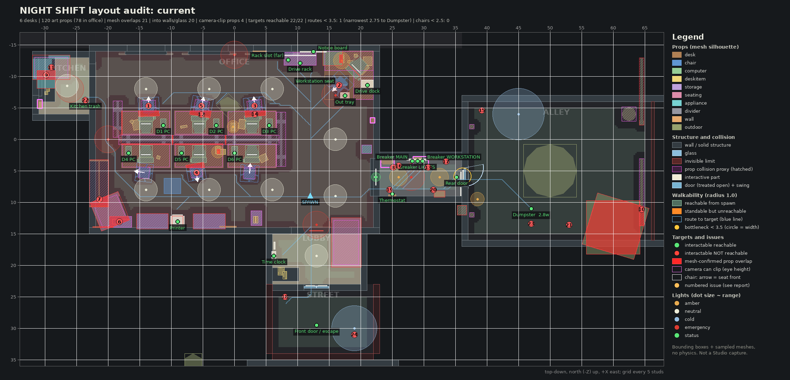

# Layout audit: current

Source: `src @ 2e7a3db+local changes`. Generated headlessly by `tools/audit/run.sh` from the real `MapBuilder.luau` (Lune) and the converted meshes. 
This is an offline approximation (boxes + sampled meshes, no physics, prompts measured from a 3-stud root height); confirm in a Studio playtest.

## Metrics

| Metric | before | current |
|---|---|---|
| Desks (Layout.DESKS) | 6 | 6 |
| Art props placed (visible) | 152 | 120 |
| Art props indoors | 131 | 101 |
| Art props in the main office | 96 | 78 |
| Avg objects on a desk (incl. PC kit) | 7.17 | 5.5 |
| Avg personal objects per desk | 3.17 | 1.5 |
| Weathered / trash / hazard props indoors | 11 | 1 |
| Weathered / trash props outdoors | 10 | 8 |
| Dirty-named surface textures indoors (faces) | 0 | 0 |
| Worst painted-wall texture: % dark blotch pixels | 0.87 | 0.0 |
| Worst ceiling texture: % dark blotch pixels | 29.9 | 7.04 |
| Prop-prop box overlaps (> 0.05, not resting) | 57 | 36 |
| ...of which mesh surfaces meet | 40 | 21 |
| Deepest mesh-confirmed prop overlap | 2.339 | 1.748 |
| Props into walls / glass / ceiling (> 0.1) | 25 | 20 |
| Props touching wall trim | 10 | 45 |
| Props inside other furniture collision | 42 | 31 |
| Props sunk below floor / desk top | 18 | 13 |
| Camera-clip props (eye-zone overhang > 0.3) | 4 | 4 |
| Largest eye-zone overhang (99 = no collision) | 1.488 | 1.488 |
| Props whose mesh renders far from its anchor | 25 | 20 |
| Art keys with implausible size (heuristic) | 9 | 9 |
| Interactables reachable | 22 | 22 |
| Interactables checked | 22 | 22 |
| Routes narrower than 3.5 | 1 | 1 |
| Narrowest route width | 2.44 | 2.75 |
| ...to | Dumpster | Dumpster |
| Chairs with < 2.5 free behind | 0 | 0 |
| Least free floor behind a chair | 4.55 | 4.55 |
| Chairs not facing their desk (> 45 deg) | 6 | 6 |
| Walkable area reachable from spawn (sq studs) | 1327.1 | 1337.1 |
| Standable but unreachable area (sq studs) | 0.2 | 0.0 |
| Lights | 30 | 26 |
| Amber lights | 14 | 6 |
| Cold lights | 8 | 3 |
| Collision proxies | 41 | 41 |
| Issues listed | 150 | 102 |

## Top issues

| # | Severity | Kind | Issue |
|---|---|---|---|
| 1 | high | chair-facing | Desk 1 chair office_chair_black#1 at (-13.6, -5.3) faces backwards (backrest against the desk): seat front is 179 deg off the desk direction (model's native front is not +Z; add a yaw for office_chair_black). |
| 2 | high | chair-facing | Workstation chair office_chair_grey#2 at (16.6, -8.6) faces backwards (backrest against the desk): seat front is 179 deg off the desk direction (model's native front is not +Z; add a yaw for office_chair_grey). |
| 3 | high | chair-facing | Desk 3 chair office_chair_blue#1 at (3.2, -5.3) faces backwards (backrest against the desk): seat front is 175 deg off the desk direction (model's native front is not +Z; add a yaw for office_chair_blue). |
| 4 | high | chair-facing | Desk 5 chair office_chair_black_alt#1 at (-6.0, 5.3) faces backwards (backrest against the desk): seat front is 172 deg off the desk direction (model's native front is not +Z; add a yaw for office_chair_black_alt). |
| 5 | high | chair-facing | Desk 2 chair office_chair_grey#1 at (-5.2, -5.3) faces backwards (backrest against the desk): seat front is 168 deg off the desk direction (model's native front is not +Z; add a yaw for office_chair_grey). |
| 6 | high | prop-overlap | armchair_pattern#1 intersects book_case_with_back_small#1 by 1.75 studs at (-18.2, 2.1, 13.1) (mesh surfaces meet: 529 voxels). |
| 7 | high | prop-overlap | armchair_pattern#1 intersects whiteboard#1 by 1.74 studs at (-21.4, 2.1, 9.5) (mesh surfaces meet: 178 voxels). |
| 8 | high | camera-clip | panel_electric#1 at (24.2, 3.2, 3.6): mesh at eye height reaches 1.49 studs beyond the collision footprint (worst point (25.1, 5.1, 4.5)); a first-person camera walking up to it can enter the mesh. |
| 9 | high | prop-overlap | fridge#1 intersects coffee_machine#1 by 1.46 studs at (-29.8, 4.8, -10.2) (mesh surfaces meet: 174 voxels). |
| 10 | high | prop-overlap | plackard_broken#1 intersects wood_pallet#2 by 1.35 studs at (64.5, 0.9, 11.1) (mesh surfaces meet: 156 voxels). |
| 11 | high | into-structure | fridge#1 penetrates wall 'Counter' by 1.29 studs (mesh) near (-29.0, 3.2, -11.4). |
| 12 | high | prop-overlap | office_chair_grey#1 intersects desk2_alt#1 by 1.16 studs at (-5.2, 1.6, -3.9) (mesh surfaces meet: 114 voxels). |
| 13 | high | camera-clip | panel_electrical_open#1 at (29.5, 3.1, 3.6): mesh at eye height reaches 1.12 studs beyond the collision footprint (worst point (30.7, 4.0, 4.5)); a first-person camera walking up to it can enter the mesh. |
| 14 | high | prop-overlap | office_chair_blue#1 intersects desk2_alt2#1 by 1.04 studs at (3.2, 1.6, -4.0) (mesh surfaces meet: 120 voxels). |
| 15 | high | mesh-offset | metaltrashcan_overflowing x1: the converted mesh sits 121 studs from its anchor, so it renders near (144.1, 54.9) (outside the playable map) instead of (39.2, -4.6). Its collision proxy is built from the same bounds, so the collision moved too. Re-centre the model in tools/convert_assets.py or compensate in MapBuilder. |
| 16 | high | mesh-offset | vent_cover x1: the converted mesh sits 118 studs from its anchor, so it renders near (143.7, -5.8) (outside the playable map) instead of (26.0, 4.2). Re-centre the model in tools/convert_assets.py or compensate in MapBuilder. |
| 17 | high | mesh-offset | pipe x4: the converted mesh sits 117 studs from its anchor, so it renders near (149.6, -13.5) (outside the playable map) instead of (33.5, 3.5), (30.0, 3.5), (26.5, 3.5), (23.0, 3.5). Re-centre the model in tools/convert_assets.py or compensate in MapBuilder. |
| 18 | high | mesh-offset | metaltrashcan_closed x2: the converted mesh sits 113 studs from its anchor, so it renders near (-90.0, -31.0) (outside the playable map) instead of (8.0, 25.0), (38.6, 14.6). Its collision proxy is built from the same bounds, so the collision moved too. Re-centre the model in tools/convert_assets.py or compensate in MapBuilder. |
| 19 | high | mesh-offset | duct_corner_rounded x1: the converted mesh sits 112 studs from its anchor, so it renders near (135.7, -9.5) (outside the playable map) instead of (24.6, 8.0). Re-centre the model in tools/convert_assets.py or compensate in MapBuilder. |
| 20 | high | mesh-offset | duct_long x2: the converted mesh sits 112 studs from its anchor, so it renders near (143.5, 8.0) (outside the playable map) instead of (31.5, 8.0), (28.0, 8.0). Re-centre the model in tools/convert_assets.py or compensate in MapBuilder. |
| 21 | high | mesh-offset | dumpster_trashpile_1 x1: the converted mesh sits 85 studs from its anchor, so it renders near (-20.5, 55.6) (outside the playable map) instead of (53.0, 13.6). Re-centre the model in tools/convert_assets.py or compensate in MapBuilder. |
| 22 | high | mesh-offset | trash_can x1: the converted mesh sits 84 studs from its anchor, so it renders near (-76.1, -71.8) (outside the playable map) instead of (-23.6, -6.2). Its collision proxy is built from the same bounds, so the collision moved too. Re-centre the model in tools/convert_assets.py or compensate in MapBuilder. |
| 23 | high | mesh-offset | dumpster_lid_closed x1: the converted mesh sits 79 studs from its anchor, so it renders near (-19.5, 55.4) (outside the playable map) instead of (47.0, 13.4). Its collision proxy is built from the same bounds, so the collision moved too. Re-centre the model in tools/convert_assets.py or compensate in MapBuilder. |
| 24 | high | mesh-offset | street_light x3: the converted mesh sits 57 studs from its anchor, so it renders near (-17.1, 75.3) (outside the playable map) instead of (19.0, 31.0), (45.0, -5.2), (-6.0, -24.0). Re-centre the model in tools/convert_assets.py or compensate in MapBuilder. |
| 25 | high | mesh-offset | trashbag_1 x1: the converted mesh sits 53 studs from its anchor, so it renders near (-6.5, 35.6) (outside the playable map) instead of (42.5, 14.6). Re-centre the model in tools/convert_assets.py or compensate in MapBuilder. |
| 26 | high | mesh-offset | trashbag_2_white x1: the converted mesh sits 49 studs from its anchor, so it renders near (-0.8, -5.2) (inside the Office area) instead of (43.8, 14.4). Re-centre the model in tools/convert_assets.py or compensate in MapBuilder. |
| 27 | high | mesh-offset | concrete_retro_bollard_light x1: the converted mesh sits 3 studs from its anchor, so it renders near (36.0, 11.2) (inside the Alley area) instead of (38.5, 9.5). Its collision proxy is built from the same bounds, so the collision moved too. Re-centre the model in tools/convert_assets.py or compensate in MapBuilder. |
| 28 | high | prop-overlap | office_chair_black#1 intersects desk2#1 by 0.91 studs at (-13.6, 1.6, -4.0) (mesh surfaces meet: 120 voxels). |
| 29 | high | chair-facing | Desk 4 chair office_chair_grey_alt#1 at (-14.4, 5.3) faces sideways: seat front is 81 deg off the desk direction (model's native front is not +Z; add a yaw for office_chair_grey_alt). |
| 30 | high | prop-overlap | office_chair_black_alt#1 intersects desk2_alt4#1 by 0.89 studs at (-6.0, 1.6, 4.1) (mesh surfaces meet: 83 voxels). |

72 more in `tools/audit/out/current.json`.

## Interactables and routes

Reachable = some cell a character (radius 1.0) can reach from the spawn is within the prompt distance minus 1 stud (3D, root at y = 3.0). Route width = widest route from the spawn (2 x clearance at its bottleneck). Doors treated open: RearDoor, FrontDoor2, FrontDoor1.

| Target | Position | Prompt | Reach | Reachable | Closest | Route width | Bottleneck |
|---|---|---|---|---|---|---|---|
| Desk 1 tower | (-11.2, 4.2, -2.2) | Shut down PC | 8 | yes | 3.6 | 6.6 | (6.1, -9.1) |
| Desk 2 tower | (-2.9, 4.2, -2.2) | Shut down PC | 8 | yes | 3.6 | 6.6 | (6.1, -9.1) |
| Desk 3 tower | (5.6, 4.2, -2.2) | Shut down PC | 8 | yes | 3.6 | 8.2 | (12.4, -3.1) |
| Desk 4 tower | (-16.8, 4.2, 2.2) | Shut down PC | 8 | yes | 2.4 | 4.8 | (3.1, 8.6) |
| Desk 5 tower | (-8.4, 4.2, 2.2) | Shut down PC | 8 | yes | 3.6 | 4.8 | (3.1, 8.6) |
| Desk 6 tower | (0.1, 4.2, 2.2) | Shut down PC | 8 | yes | 3.6 | 4.8 | (3.1, 8.6) |
| Drive dock | (21.1, 3.6, -8.6) | Connect drive | 8 | yes | 3.3 | 7.8 | (17.6, -2.6) |
| Workstation seat | (16.6, 2.6, -8.6) | Use workstation | 9 | yes | 0.4 | 10.7 | (12.1, 9.1) |
| Drive rack | (10.4, 2.6, -12.1) | Stage drive | 8 | yes | 1.5 | 8.6 | (12.4, -5.4) |
| Rack slot (far) | (8.6, 4.5, -12.6) | Take drive | 7 | yes | 2.2 | 8.3 | (10.9, -7.4) |
| Breaker LIGHTS | (29.0, 4.6, 3.4) | Reset breaker | 8 | yes | 2.0 | 5.8 | (22.1, 5.9) |
| Breaker MAIN | (28.2, 4.6, 3.4) | Reset breaker | 8 | yes | 2.0 | 5.8 | (21.9, 5.9) |
| Breaker WORKSTATION | (29.8, 4.6, 3.4) | Reset breaker | 8 | yes | 2.0 | 5.8 | (22.1, 5.9) |
| Rear door | (35.2, 3.6, 6.0) | Open door | 9 | yes | 0.6 | 5.2 | (27.4, 6.1) |
| Kitchen trash | (-23.6, 1.8, -6.2) | Take trash bag | 10 | yes | 1.3 | 6.6 | (6.1, -9.1) |
| Dumpster | (47.0, 3.0, 11.0) | Throw bag away | 10 | yes | 0.2 | 2.8 (narrow) | (36.1, 5.9) |
| Thermostat | (25.0, 4.8, 8.7) | Read thermostat | 10 | yes | 2.0 | 10.7 | (12.1, 9.1) |
| Printer | (-9.0, 4.2, 13.1) | Take printout | 10 | yes | 2.3 | 4.8 | (3.1, 8.6) |
| Out tray | (17.5, 3.2, -6.9) | Leave printout | 10 | yes | 1.6 | 10.7 | (12.1, 9.1) |
| Time clock | (6.2, 4.2, 18.5) | Clock out | 8 | yes | 1.8 | 5.8 | (11.9, 14.1) |
| Notice board | (12.5, 5.6, -13.9) | (read) | 8 | yes | 4.2 | 8.2 | (10.9, -7.6) |
| Front door / escape | (13.0, 4.0, 29.5) | (walk in) | 10 | yes | 0.0 | 3.8 | (12.9, 23.1) |

Prompt parents closer than 2.5 studs (the custom prompt must pick one): Workstation seat / Out tray 2.0; Breaker LIGHTS / Breaker MAIN 0.8; Breaker LIGHTS / Breaker WORKSTATION 0.8; Breaker MAIN / Breaker WORKSTATION 1.6.

## Prop overlaps

OBB separating-axis depth > 0.05; items resting on a desk/cabinet top or stored in storage are excluded (5 nested pairs, 7 shallow vertical contacts up to 0.2). Mesh = sampled surfaces of both meshes share 4+ voxels of 0.1 stud.

| A | B | Depth | Axis | Mesh | At |
|---|---|---|---|---|---|
| duct_long#2 | duct_long#1 | 3.50 | horizontal | yes (10368) offset mesh | (141.8, 8.3, 8.0) |
| office_chair_grey#2 | desk2_corner#1 | 3.25 | vertical | no (0) | (16.7, 1.6, -8.7) |
| armchair_pattern#1 | book_case_with_back_small#1 | 1.75 | horizontal | yes (529) | (-18.2, 2.1, 13.1) |
| armchair_pattern#1 | whiteboard#1 | 1.74 | horizontal | yes (178) | (-21.4, 2.1, 9.5) |
| fridge#1 | coffee_machine#1 | 1.46 | horizontal | yes (174) | (-29.8, 4.8, -10.2) |
| plackard_broken#1 | wood_pallet#2 | 1.35 | vertical | yes (156) | (64.5, 0.9, 11.1) |
| office_chair_grey#1 | desk2_alt#1 | 1.16 | horizontal | yes (114) | (-5.2, 1.6, -3.9) |
| trashbag_2_white#1 | desk2_alt2#1 | 1.15 | horizontal | yes (138) offset mesh | (0.1, 1.6, -3.9) |
| office_chair_blue#1 | desk2_alt2#1 | 1.04 | horizontal | yes (120) | (3.2, 1.6, -4.0) |
| office_chair_black#1 | desk2#1 | 0.91 | horizontal | yes (120) | (-13.6, 1.6, -4.0) |
| office_chair_black_alt#1 | desk2_alt4#1 | 0.89 | horizontal | yes (83) | (-6.0, 1.6, 4.1) |
| armchair_pattern#1 | books#1 | 0.87 | vertical | yes (90) | (-18.0, 3.7, 13.1) |
| office_chair_grey_alt#1 | desk2_alt3#1 | 0.81 | horizontal | no (0) | (-14.3, 1.6, 4.1) |
| door_brown_a#1 | armchair_pattern#1 | 0.75 | horizontal | yes (364) | (-20.8, 1.6, 13.9) |
| dumpster_trashpile_1#1 | dumpster_lid_closed#1 | 0.61 | vertical | yes (122) offset mesh | (-20.2, 0.3, 55.6) |
| circular_desklamp#2 | desktop_brick#1 | 0.50 | horizontal | yes (44) | (16.9, 3.8, -12.8) |
| square_desklamp#1 | books_alt#1 | 0.48 | horizontal | yes (70) | (-2.5, 3.7, 2.0) |
| office_chair_blue_alt#1 | desk2#2 | 0.46 | horizontal | no (0) | (2.4, 1.6, 4.3) |
| divider_black_low#4 | divider_black_low#3 | 0.40 | horizontal | no (0) | (6.9, 2.1, 0.1) |
| desk_phone_with_cable#1 | computer_monitor#7 | 0.34 | vertical | no (0) | (20.9, 3.3, -12.4) |
| divider_black_low_half#1 | divider_black_low#1 | 0.32 | horizontal | no (0) | (-18.0, 2.1, -0.5) |
| wood_pallet#2 | wood_pallet#1 | 0.25 | vertical | yes (354) | (60.0, 0.7, 14.0) |
| trashbag_2_white#1 | desk2_alt#1 | 0.21 | horizontal | yes (58) offset mesh | (-2.3, 1.6, -3.9) |
| divider_black_low#3 | desk2#2 | 0.17 | horizontal | no (0) | (2.8, 1.6, 0.8) |
| divider_black_low#2 | desk2_alt4#1 | 0.17 | horizontal | yes (42) | (-5.6, 1.6, 0.8) |
| divider_black_low#1 | desk2_alt3#1 | 0.17 | horizontal | yes (42) | (-14.0, 1.6, 0.8) |
| divider_black_low#3 | divider_black_low#2 | 0.17 | horizontal | yes (390) | (-1.4, 2.1, 0.1) |
| divider_black_low#2 | divider_black_low#1 | 0.17 | horizontal | yes (170) | (-9.8, 2.1, 0.1) |
| door_brown_a#1 | book_case_with_back_small#1 | 0.12 | horizontal | yes (243) | (-19.5, 1.6, 13.9) |
| divider_black_low_half#1 | desk2#1 | 0.11 | horizontal | yes (6) | (-17.8, 1.6, -2.6) |
| computer_keyboard#1 | office_chair_black#1 | 0.10 | horizontal | no (0) | (-14.0, 3.2, -3.6) |
| plackard_broken#1 | wood_pallet#1 | 0.10 | horizontal | yes (26) | (64.2, 0.4, 11.8) |
| paper_single_sheet#1 | computer_keyboard#6 | 0.10 | horizontal | no (0) | (3.9, 3.2, 3.3) |
| mug_alt#1 | computer_monitor#7 | 0.10 | horizontal | no (0) | (19.2, 3.3, -13.2) |
| computer_keyboard#7 | computer_monitor#7 | 0.07 | horizontal | yes (46) | (19.0, 3.2, -11.0) |
| computer_keyboard#4 | office_chair_black_alt#1 | 0.06 | horizontal | no (0) | (-5.6, 3.2, 3.7) |

## Props into structure, fixtures and other collision

| Prop | Into | Kind | Mesh depth | Box depth | Points | At |
|---|---|---|---|---|---|---|
| fridge#1 | Counter | wall | 1.29 | 3.10 | 14744 | (-29.0, 3.2, -11.4) |
| plackard_closed#1 | AlleyNorth | wall | 0.50 | 4.75 | 8778 | (64.5, 4.4, -7.6) |
| concrete_retro_bollard_light#1 | RearWall | wall | 0.50 | 0.80 | 6359 | (36.0, 2.3, 11.2) |
| wood_pallet#2 | AlleySouth | wall | 0.50 | 1.35 | 3687 | (60.4, 0.9, 13.8) |
| armchair_pattern#1 | WallWest | wall | 0.50 | 0.84 | 10085 | (-19.7, 2.1, 11.4) |
| armchair_pattern#1 | WallSouth | wall | 0.50 | 0.61 | 6923 | (-19.7, 2.1, 11.4) |
| desktop_brick#1 | WallNorth | wall | 0.50 | 0.54 | 4595 | (15.6, 3.9, -13.1) |
| couch_pattern#1 | WallSouth | wall | 0.50 | 2.52 | 11228 | (17.7, 2.1, 16.4) |
| wall_clock#2 | WallSouth | wall | 0.50 | 0.52 | 2561 | (13.0, 8.4, 14.5) |
| whiteboard#1 | WallWest | wall | 0.49 | 0.90 | 1448 | (-21.4, 4.5, 7.0) |
| fridge#1 | KitchenWest | wall | 0.49 | 0.54 | 1946 | (-29.0, 3.2, -11.4) |
| fridge#1 | KitchenWest | wall | 0.49 | 0.95 | 9257 | (-29.0, 3.2, -11.4) |
| wood_pallet#1 | AlleySouth | wall | 0.48 | 0.80 | 3509 | (60.0, 0.4, 14.0) |
| fridge#1 | KitchenNorth | wall | 0.34 | 0.34 | 5477 | (-29.0, 3.2, -11.4) |
| panel_electrical_closed#1 | Counter | wall | 0.30 | 0.30 | 74 | (-30.8, 4.2, -5.6) |
| coffee_machine#1 | KitchenWest | wall | 0.26 | 0.26 | 3538 | (-29.8, 5.5, -9.5) |
| fire_extenguisher_case#1 | WallEast | wall | 0.26 | 0.26 | 811 | (21.9, 3.5, -3.0) |
| coffee_machine#1 | KitchenWest | wall | 0.25 | 0.26 | 1263 | (-29.8, 5.5, -9.5) |
| coffee_machine#1 | KitchenWest | wall | 0.25 | 0.26 | 6847 | (-29.8, 5.5, -9.5) |
| panel_electrical_open#1 | HallNorth | wall | 0.24 | 0.24 | 587 | (29.5, 3.1, 3.6) |
| panel_electric#1 | HallNorth | wall | 0.24 | 0.24 | 2907 | (24.2, 3.2, 3.6) |
| file_cabinet_larger_open#1 | WallSouth | wall | 0.23 | 0.23 | 9502 | (-4.0, 1.9, 13.0) |
| file_cabinet_largest#1 | WallSouth | wall | 0.23 | 0.23 | 7019 | (-13.0, 2.5, 13.0) |
| panel_heater#1 | HallSouth | wall | 0.21 | 0.21 | 462 | (32.5, 0.4, 8.7) |
| panel_electrical_closed#1 | KitchenWest | wall | 0.21 | 0.21 | 569 | (-30.8, 4.2, -5.6) |
| door_brown_a#1 | WallWest | wall | 0.14 | 0.14 | 1910 | (-20.8, 0.0, 13.9) |
| couch_pattern#1 | LobbyEast | wall | 0.11 | 0.11 | 8070 | (17.7, 2.1, 16.4) |
| fridge#1 | KitchenWindowSill | wall | 0.10 | 0.69 | 123 | (-29.0, 3.2, -11.4) |
| coffee_machine#1 | KitchenWindowSill | wall | 0.10 | 0.50 | 371 | (-29.8, 5.5, -9.5) |
| fridge#1 | KitchenWindow | glass | 0.07 | 0.52 | 122 | (-29.0, 3.2, -11.4) |
| file_cabinet_small#1 | Printer | fixture | 0.25 | 1.33 | 1300 | (-9.0, 2.5, 13.1) |
| panel_electrical_open#1 | Breaker_LIGHTS | fixture | 0.14 | 0.71 | 52 | (29.5, 3.1, 3.6) |
| panel_electrical_open#1 | Breaker_WORKSTATION | fixture | 0.13 | 0.71 | 219 | (29.5, 3.1, 3.6) |
| panel_electrical_open#1 | Breaker_MAIN | fixture | 0.13 | 0.13 | 142 | (29.5, 3.1, 3.6) |
| panel_electrical_open#1 | BreakerBacking | fixture | 0.10 | 0.59 | 65 | (29.5, 3.1, 3.6) |
| desktop_brick#1 | NoticeBoard | fixture | 0.07 | 0.56 | 35 | (15.6, 3.9, -13.1) |
| electrical_junctionbox_small#1 | BreakerBacking | fixture | 0.05 | 0.10 | 2 | (31.4, 5.2, 3.1) |
| file_cabinet_small#1 | PrinterTray | fixture | 0.03 | 0.13 | 93 | (-9.0, 2.5, 13.1) |
| panel_electrical_open#1 | BreakerTag_WORKSTATION | fixture | 0.03 | 0.82 | 3 | (29.5, 3.1, 3.6) |
| book_case_with_back_small#1 | office__couches__armchair_pattern_Collision (armchair_pattern#1) | collision | 1.35 | 1.35 | 13723 | (-18.0, 4.4, 13.1) |
| armchair_pattern#1 | office__extras__whiteboard_Collision (whiteboard#1) | collision | 1.33 | 1.74 | 24795 | (-19.7, 2.1, 11.4) |
| coffee_machine#1 | cute3d__blend__fridge_Collision (fridge#1) | collision | 1.16 | 1.16 | 20731 | (-29.8, 5.5, -9.5) |
| armchair_pattern#1 | office__book_things__book_case_with_back_small_Collision (book_case_with_back_small#1) | collision | 0.88 | 1.75 | 19487 | (-19.7, 2.1, 11.4) |
| books#1 | office__book_things__book_case_with_back_small_Collision (book_case_with_back_small#1) | collision | 0.88 | 1.27 | 9196 | (-18.0, 3.9, 13.1) |
| whiteboard#1 | office__couches__armchair_pattern_Collision (armchair_pattern#1) | collision | 0.79 | 1.34 | 13640 | (-21.4, 4.5, 7.0) |
| books#1 | office__couches__armchair_pattern_Collision (armchair_pattern#1) | collision | 0.73 | 0.73 | 1746 | (-18.0, 3.9, 13.1) |
| dumpster_trashpile_1#1 | urban__litter__dumpsters__dumpster_lid_closed_Collision (dumpster_lid_closed#1) | collision | 0.61 | 0.61 | 1142 | (-20.5, -1.4, 55.6) |
| paper_single_sheet#1 | office__desks__desk2_Collision (desk2#2) | collision | 0.52 | 0.52 | 768 | (4.6, 3.1, 3.0) |
| divider_black_low#3 | office__dividers__divider_black_low_Collision (divider_black_low#4) | collision | 0.40 | 0.40 | 16172 | (2.8, 2.1, 0.1) |
| office_chair_black_alt#1 | office__desks__desk2_alt4_Collision (desk2_alt4#1) | collision | 0.38 | 0.79 | 3154 | (-6.0, 1.4, 5.2) |

Sunk below support (mesh lowest point under the surface the prop stands on):

| Prop | Support | Below | At |
|---|---|---|---|
| door_brown_a#1 | FloorMain | 3.31 | (-20.8, 0.0, 13.9) |
| yellow_post#2 | FloorAlley | 2.40 | (37.6, 0.0, 12.0) |
| yellow_post#1 | FloorAlley | 2.40 | (37.6, 0.0, -2.0) |
| metal_rack_stackable#1 | FloorMain | 1.34 | (10.4, 0.0, -12.7) |
| office_chair_grey#2 | FloorMain | 0.59 | (16.6, 0.0, -8.6) |
| office_chair_blue#1 | FloorMain | 0.59 | (3.2, 0.0, -5.3) |
| office_chair_grey#1 | FloorMain | 0.59 | (-5.2, 0.0, -5.3) |
| office_chair_black#1 | FloorMain | 0.59 | (-13.6, 0.0, -5.3) |
| office_chair_blue_alt#1 | FloorMain | 0.52 | (2.4, 0.0, 5.3) |
| office_chair_black_alt#1 | FloorMain | 0.52 | (-6.0, 0.0, 5.3) |
| office_chair_grey_alt#1 | FloorMain | 0.52 | (-14.4, 0.0, 5.3) |
| paper_single_sheet#1 | desk2#2 | 0.52 | (4.6, 3.1, 3.0) |
| manhole_cover#1 | FloorAlley | 0.15 | (50.0, 0.0, 5.0) |

## Camera clipping coverage

Props taller than 1.2 studs (or wall-mounted) with mesh points at 3.0..6.5 studs within 1.0 stud of floor a body can reach face-first. Overhang = horizontal distance from those points to the footprint of the nearest CanCollide part a walking body bumps into (0.4..5.5 studs). Eye zone 4.0..5.8 (camera ~4.5-5 plus near-plane slack): flag (**CLIP**) above 0.3; overhangs outside the eye zone are listed as low. 99 = no collision nearby.

| Prop | At | Height | Eye overhang | Low overhang | Own proxy | Flag |
|---|---|---|---|---|---|---|
| panel_electric#1 | (24.2, 3.2, 3.6) | 4.2 | 1.49 | 0.95 | no | **CLIP** |
| panel_electrical_open#1 | (29.5, 3.1, 3.6) | 3.5 | 1.12 | 1.12 | no | **CLIP** |
| panel_electrical_closed#1 | (-30.8, 4.2, -5.6) | 3.5 | 0.57 | 0.57 | no | **CLIP** |
| fire_extenguisher_case#1 | (21.9, 3.4, -3.0) | 2.0 | 0.46 | 0.46 | no | **CLIP** |
| electrical_junctionbox_small#1 | (31.4, 5.2, 3.1) | 0.4 | 0.29 | 0.00 | no |  |
| panel_thermostat#1 | (25.0, 4.6, 8.9) | 1.1 | 0.21 | 0.00 | no |  |
| desktop_brick#1 | (15.6, 3.1, -13.1) | 1.7 | 0.20 | 0.26 | no |  |
| sign_nosmoking#1 | (-1.0, 6.2, 13.9) | 2.6 | 0.17 | 0.17 | no |  |
| coffee_machine#1 | (-29.8, 3.1, -9.5) | 4.8 | 0.06 | 0.06 | no |  |
| conference_chair_grey#1 | (-9.8, 0.0, 7.4) | 3.5 | 0.00 | 2.13 | no |  |
| office_chair_grey#2 | (16.7, 0.0, -8.7) | 3.8 | 0.00 | 1.64 | no |  |
| trashbag_2_white#1 | (-0.8, 0.0, -5.2) | 3.6 | 0.00 | 1.56 | no |  |
| desk2_corner#1 | (18.1, 0.0, -10.2) | 3.1 | 0.00 | 0.73 | no |  |
| couch_pattern#1 | (17.7, 0.0, 16.4) | 4.2 | 0.00 | 0.56 | yes |  |
| wall_clock#1 | (4.0, 7.2, -14.0) | 2.1 | 0.00 | 0.53 | no |  |
| armchair_pattern#1 | (-19.7, 0.0, 11.4) | 4.2 | 0.00 | 0.51 | yes |  |
| computer_keyboard#7 | (18.7, 3.1, -10.7) | 0.1 | 0.00 | 0.47 | no |  |
| office_chair_blue_alt#1 | (2.4, 0.0, 5.4) | 3.9 | 0.00 | 0.36 | yes |  |
| office_chair_grey_alt#1 | (-14.3, 0.0, 5.3) | 3.9 | 0.00 | 0.36 | yes |  |
| fridge#1 | (-29.0, 0.0, -11.4) | 6.4 | 0.00 | 0.17 | yes |  |
| desk2#2 | (2.8, 0.0, 2.6) | 3.1 | 0.00 | 0.13 | yes |  |
| desk2_alt4#1 | (-5.6, 0.0, 2.6) | 3.1 | 0.00 | 0.13 | yes |  |
| desk2_alt3#1 | (-14.0, 0.0, 2.6) | 3.1 | 0.00 | 0.13 | yes |  |
| desk2_alt2#1 | (2.8, 0.0, -2.6) | 3.1 | 0.00 | 0.13 | yes |  |
| desk2_alt#1 | (-5.6, 0.0, -2.6) | 3.1 | 0.00 | 0.13 | yes |  |
| desk2#1 | (-14.0, 0.0, -2.6) | 3.1 | 0.00 | 0.13 | yes |  |
| papers_log_1_stack#1 | (7.4, 3.1, 21.0) | 0.0 | 0.00 | 0.04 | no |  |
| plackard_broken#1 | (64.5, 0.0, 8.4) | 8.8 | 0.00 | 0.00 | yes |  |
| plackard_closed#1 | (64.5, 0.0, -7.6) | 8.8 | 0.00 | 0.00 | yes |  |
| concrete_retro_bollard_light#1 | (36.0, 0.0, 11.2) | 4.5 | 0.00 | 0.00 | yes |  |
| barrel#1 | (62.5, 0.0, -4.0) | 3.0 | 0.00 | 0.00 | yes |  |
| telephone#1 | (8.0, 3.1, 21.6) | 0.6 | 0.00 | 0.00 | no |  |
| file_cabinet_small#1 | (-9.0, 0.0, 13.1) | 4.9 | 0.00 | 0.00 | yes |  |
| water_cooler_bottle_attached#1 | (21.0, 0.0, 1.6) | 6.5 | 0.00 | 0.00 | yes |  |
| whiteboard#1 | (-21.4, 0.0, 7.0) | 9.0 | 0.00 | 0.00 | yes |  |
| file_binder_alt2#1 | (3.6, 3.7, 12.8) | 1.5 | 0.00 | 0.00 | no |  |
| file_binder_alt#1 | (3.2, 3.7, 12.8) | 1.5 | 0.00 | 0.00 | no |  |
| file_cabinet_smaller_with_shelfs#1 | (3.5, 0.0, 12.5) | 3.7 | 0.00 | 0.00 | yes |  |
| file_cabinet_larger_open#1 | (-4.0, 0.0, 13.0) | 3.7 | 0.00 | 0.00 | yes |  |
| file_cabinet_largest#1 | (-13.0, 0.0, 13.0) | 4.9 | 0.00 | 0.00 | yes |  |

## Chairs

Facing = angle between the seat front (inferred from the backrest in the mesh) and the direction to the desk; 0 is correct, 180 is backwards.

| Desk | Chair | At | Free behind (target 2.5) | Facing error |
|---|---|---|---|---|
| Desk 1 | office_chair_black#1 | (-13.6, -5.3) | 7.3 | 179 deg **wrong** |
| Desk 2 | office_chair_grey#1 | (-5.2, -5.3) | 7.1 | 168 deg **wrong** |
| Desk 3 | office_chair_blue#1 | (3.2, -5.3) | 7.2 | 175 deg **wrong** |
| Desk 4 | office_chair_grey_alt#1 | (-14.4, 5.3) | 5.0 | 81 deg **wrong** |
| Desk 5 | office_chair_black_alt#1 | (-6.0, 5.3) | 5.1 | 172 deg **wrong** |
| Desk 6 | office_chair_blue_alt#1 | (2.4, 5.3) | 4.5 | 5 deg |
| Workstation | office_chair_grey#2 | (16.6, -8.6) | 8+ | 179 deg **wrong** |

Rear door swing: hinge (36.5, 4.5), width 3.0, opens 100 deg outward; obstructions: none.

## Scale sanity (heuristic)

| Prop | Size | Plausible | ArtScale | Suggested | At |
|---|---|---|---|---|---|
| manhole_cover#1 | 8.4 width | 2.0-3.4 | 1.20 | 0.39 | (50.0, 5.0) |
| wood_pallet#2 | 8.5 width | 3.4-4.8 | 1.60 | 0.77 | (60.4, 13.8) |
| metaltrashcan_overflowing#1 | 4.2 height | 1.8-3.8 | 1.00 | 0.67 | (39.2, -4.6) |
| trashbag_2_white#1 | 3.6 height | 1.0-2.6 | 1.00 | 0.49 | (43.8, 14.4) |
| trashbag_1#1 | 2.8 height | 1.0-2.6 | 1.00 | 0.64 | (42.5, 14.6) |
| coffee_machine#1 | 4.8 height | 1.0-2.4 | 0.65 | 0.23 | (-29.8, -9.5) |
| water_cooler_bottle_attached#1 | 6.5 height | 3.6-5.4 | 1.00 | 0.70 | (21.0, 1.6) |
| whiteboard#1 | 9.0 height | 4.5-8.0 | 1.00 | 0.70 | (-21.4, 7.0) |
| book_case_with_back_small#1 | 8.8 height | 4.5-8.0 | 1.00 | 0.71 | (-18.0, 13.1) |

## Meshes far from their anchors

The converted model's own origin is far from its geometry, so the client draws it somewhere else (ArtController uses the vertices as-is).

| Prop | Anchor | Mesh renders near | Offset |
|---|---|---|---|
| metaltrashcan_overflowing#1 | (39.2, 0.0, -4.6) | (144.1, 2.1, 54.9) (Outside) | 120.6 |
| vent_cover#1 | (26.0, 9.0, 4.2) | (143.7, 10.3, -5.8) (Outside) | 118.1 |
| pipe#4 | (33.5, 8.2, 3.5) | (149.6, 18.2, -13.5) (Outside) | 117.3 |
| pipe#3 | (30.0, 8.2, 3.5) | (146.1, 18.2, -13.5) (Outside) | 117.3 |
| pipe#2 | (26.5, 8.2, 3.5) | (142.6, 18.2, -13.5) (Outside) | 117.3 |
| pipe#1 | (23.0, 8.2, 3.5) | (139.1, 18.2, -13.5) (Outside) | 117.3 |
| metaltrashcan_closed#1 | (8.0, 0.0, 25.0) | (-90.0, 1.6, -31.0) (Outside) | 112.9 |
| metaltrashcan_closed#2 | (38.6, 0.0, 14.6) | (-59.4, 1.6, -41.4) (Outside) | 112.9 |
| duct_corner_rounded#1 | (24.6, 8.3, 8.0) | (135.7, 7.5, -9.5) (Outside) | 112.5 |
| duct_long#2 | (31.5, 8.3, 8.0) | (143.5, 8.3, 8.0) (Outside) | 112.0 |
| duct_long#1 | (28.0, 8.3, 8.0) | (140.0, 8.3, 8.0) (Outside) | 112.0 |
| dumpster_trashpile_1#1 | (53.0, 0.0, 13.6) | (-20.5, -1.4, 55.6) (Outside) | 84.7 |
| trash_can#1 | (-23.6, 0.0, -6.2) | (-76.1, 1.7, -71.8) (Outside) | 84.1 |
| dumpster_lid_closed#1 | (47.0, 0.0, 13.4) | (-19.5, 3.4, 55.4) (Outside) | 78.7 |
| street_light#2 | (19.0, 0.0, 31.0) | (-17.1, 11.6, 75.3) (Outside) | 57.1 |
| street_light#3 | (45.0, 0.0, -5.2) | (81.1, 11.6, -49.5) (Outside) | 57.1 |
| street_light#1 | (-6.0, 0.0, -24.0) | (30.1, 11.6, -68.3) (Outside) | 57.1 |
| trashbag_1#1 | (42.5, 0.0, 14.6) | (-6.5, 1.3, 35.6) (Outside) | 53.3 |
| trashbag_2_white#1 | (43.8, 0.0, 14.4) | (-0.8, 1.6, -5.2) (Office) | 48.8 |
| concrete_retro_bollard_light#1 | (38.5, 0.0, 9.5) | (36.0, 2.3, 11.2) (Alley) | 3.0 |

## Clutter

| Area | Total | appliance | chair | computer | desk | deskitem | divider | outdoor | seating | storage | wall |
|---|---|---|---|---|---|---|---|---|---|---|---|
| Alley | 16 | 0 | 0 | 0 | 0 | 0 | 0 | 16 | 0 | 0 | 0 |
| Hall | 13 | 0 | 0 | 0 | 0 | 1 | 0 | 0 | 0 | 0 | 12 |
| Kitchen | 6 | 2 | 0 | 0 | 0 | 2 | 0 | 1 | 0 | 0 | 1 |
| Lobby | 4 | 0 | 0 | 0 | 0 | 2 | 0 | 0 | 1 | 0 | 1 |
| Office | 78 | 1 | 8 | 28 | 7 | 17 | 5 | 0 | 1 | 6 | 5 |
| Outside | 1 | 0 | 0 | 0 | 0 | 0 | 0 | 1 | 0 | 0 | 0 |
| Street | 2 | 0 | 0 | 0 | 0 | 0 | 0 | 2 | 0 | 0 | 0 |

| Desk | Model | Objects on top | PC kit | Personal | Personal items |
|---|---|---|---|---|---|
| Desk 1 | desk2 | 6 | 4 | 2 | paper_stack, mug |
| Desk 2 | desk2_alt | 5 | 4 | 1 | file_binder |
| Desk 3 | desk2_alt2 | 6 | 4 | 2 | circular_desklamp, paper_stack_large |
| Desk 4 | desk2_alt3 | 5 | 4 | 1 | mug_alt2 |
| Desk 5 | desk2_alt4 | 6 | 4 | 2 | square_desklamp, books_alt |
| Desk 6 | desk2 | 5 | 4 | 1 | paper_single_sheet |
| Workstation | desk2_corner | 9 | 4 | 5 | papers_envolope_redacted, pen2, desk_phone_with_cable, mug_alt, circular_desklamp |

Weathered / trash / hazard keys placed:

| Prop | Area | Indoor | At |
|---|---|---|---|
| trash_can#1 | Kitchen | yes | (-23.6, -6.2) |
| plackard_broken#1 | Alley | no | (64.5, 13.4) |
| dumpster_lid_closed#1 | Alley | no | (47.0, 13.4) |
| dumpster_trashpile_1#1 | Alley | no | (53.0, 13.6) |
| metaltrashcan_closed#2 | Alley | no | (38.6, 14.6) |
| metaltrashcan_overflowing#1 | Alley | no | (39.2, -4.6) |
| trashbag_1#1 | Alley | no | (42.5, 14.6) |
| trashbag_2_white#1 | Alley | no | (43.8, 14.4) |
| metaltrashcan_closed#1 | Street | no | (8.0, 25.0) |

Surface textures used indoors (blotch = pixels darker than 70% of the median luminance; walls should read as clean, light paint, about 205-226 albedo):

| Surface | Used on | Mean RGB | Median lum | Blotch % | Lum std | Same image as |
|---|---|---|---|---|---|---|
| carpet | floor x1 | (131, 111, 101) | 117 | 3.05 | 17.5 | - |
| ceiling_tile | ceiling x3 | (101, 101, 101) | 100 | 5.59 | 17.6 | - |
| floor_concrete | floor x1 | (97, 105, 79) | 102 | 0.00 | 7.0 | - |
| floor_lobby | floor x1 | (157, 148, 134) | 150 | 5.71 | 27.1 | - |
| floor_tile | floor x1 | (101, 101, 101) | 100 | 5.59 | 17.6 | ceiling_tile |
| wall_concrete | wall x2, ceiling x1 | (118, 122, 112) | 122 | 7.04 | 22.8 | - |
| wall_kitchen | wall x6 | (224, 213, 182) | 213 | 0.00 | 2.9 | - |
| wall_lower | wall x2 | (196, 162, 116) | 165 | 0.00 | 10.8 | - |
| wall_office | wall x25 | (224, 213, 182) | 213 | 0.00 | 2.9 | wall_kitchen |

## Lights

| Area | amber | neutral | cold | emergency | status |
|---|---|---|---|---|---|
| Alley | 1 | 0 | 1 | 0 | 0 |
| Hall | 2 | 0 | 0 | 1 | 1 |
| Kitchen | 0 | 1 | 0 | 1 | 0 |
| Lobby | 0 | 1 | 0 | 0 | 0 |
| Office | 3 | 8 | 0 | 4 | 0 |
| Outside | 0 | 0 | 1 | 0 | 0 |
| Street | 0 | 0 | 1 | 0 | 0 |

## Prompts declared in server code

| File | Parent | Action | Key | Hold | Distance |
|---|---|---|---|---|---|
| src/server/Events/BossRequest.luau:108 | refs.kitchenTrash | Take trash bag | E | 0.6 | 10 |
| src/server/Events/BossRequest.luau:109 | refs.dumpster | Throw bag away | E | 0.6 | 10 |
| src/server/Events/BossRequest.luau:110 | refs.thermostat | Read thermostat | E | 1.0 | 10 |
| src/server/Events/BossRequest.luau:111 | refs.printer | Take printout | E | 0.6 | 10 |
| src/server/Events/BossRequest.luau:112 | refs.outbox | Leave printout | E | 0.4 | 10 |
| src/server/Systems/Doors.luau:131 | MapBuilder.refs.doorPromptPart | Open door | E | 0.3 | 9 |
| src/server/Systems/Drives.luau:486 | p | Take drive | E | 0 | 7 |
| src/server/Systems/Drives.luau:514 | pc | Shut down PC | E | 0.8 | 8 |
| src/server/Systems/Drives.luau:541 | refs.recoveryRack | Stage drive | F | 0 | 8 |
| src/server/Systems/Drives.luau:553 | refs.dock | Connect drive | F | 0.5 | 8 |
| src/server/Systems/Finale.luau:331 | MapBuilder.refs.timeClock | Clock out | E | 0.6 | 8 |
| src/server/Systems/PlayerStatus.luau:123 | root | Help up | E | Config.DOWNED.reviveHold | 9 |
| src/server/Systems/Power.luau:154 | sw | Reset breaker | E | 0.8 | 8 |
| src/server/Systems/Workstation.luau:340 | refs.seatPromptPart | Use workstation | E | 0.2 | 9 |
| src/server/Util/Prompts.luau:29 | parent: Instance | ? | E | 0 | 10 |

_Analysis took 7.52 s._
